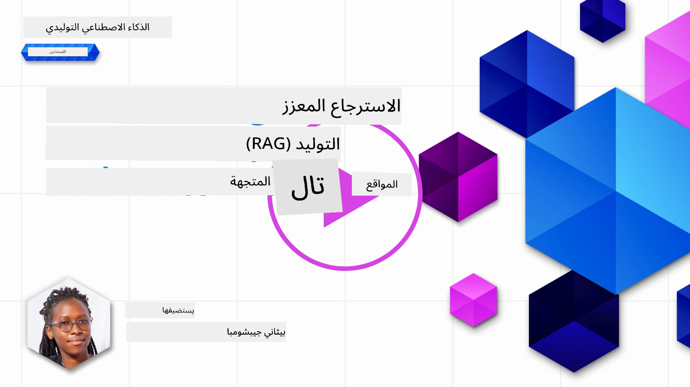
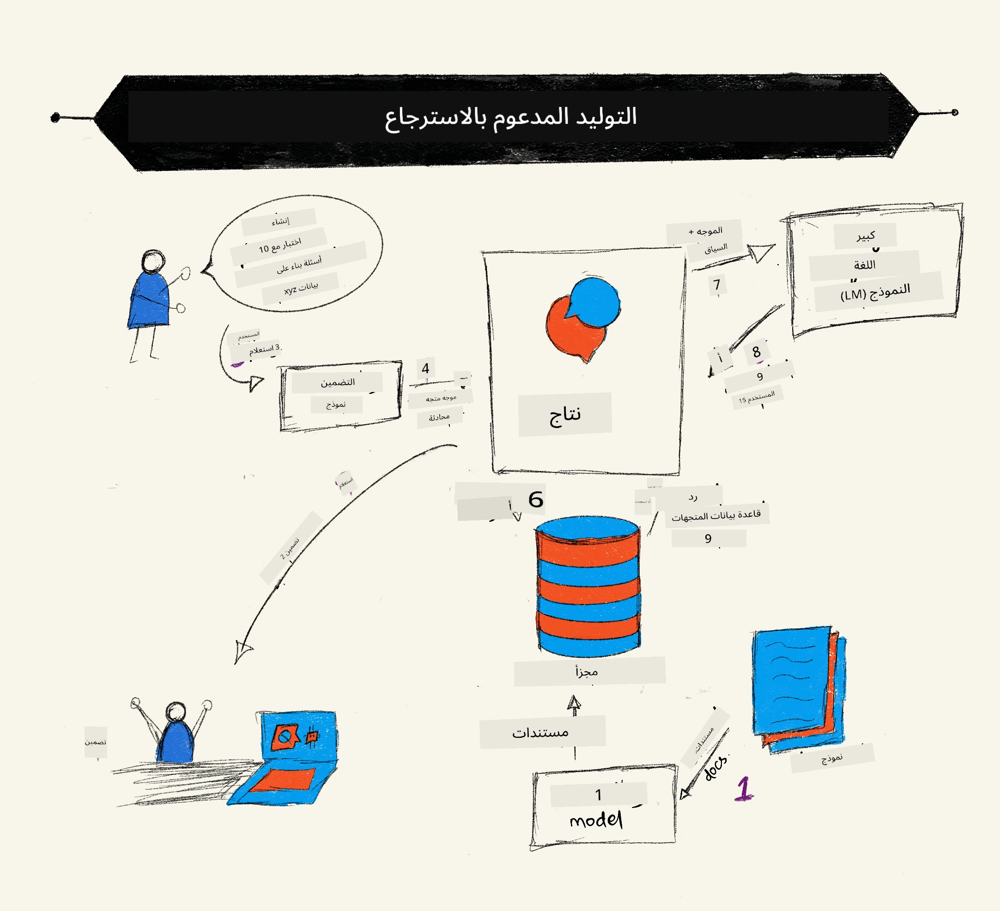
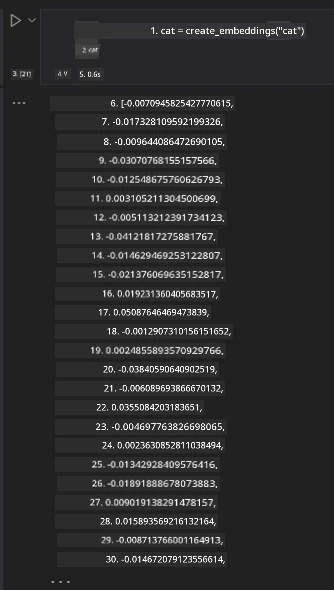

# التوليد المعزز بالاسترجاع (RAG) وقواعد بيانات المتجهات

[](https://youtu.be/4l8zhHUBeyI?si=BmvDmL1fnHtgQYkL)

في درس تطبيقات البحث، تعلمنا بإيجاز كيفية دمج بياناتك الخاصة في نماذج اللغة الكبيرة (LLMs). في هذا الدرس، سوف نستكشف أكثر مفاهيم تأصيل بياناتك في تطبيق LLM الخاص بك، آليات العملية وطرق تخزين البيانات، بما في ذلك التضمينات والنصوص.

> **الفيديو قادم قريبًا**

## المقدمة

في هذا الدرس سوف نغطي ما يلي:

- مقدمة عن RAG، ما هو ولماذا يُستخدم في الذكاء الاصطناعي.

- فهم ما هي قواعد بيانات المتجهات وكيفية إنشاء واحدة لتطبيقنا.

- مثال عملي على كيفية دمج RAG في تطبيق.

## أهداف التعلم

بعد إكمال هذا الدرس، ستتمكن من:

- شرح أهمية RAG في استرجاع البيانات ومعالجتها.

- إعداد تطبيق RAG وربط نموذج اللغة الكبير (LLM) ببياناتك

- دمج RAG وقواعد البيانات المتجهة بشكل فعال في تطبيقات LLM.

## سيناريو الخاص بنا: تعزيز نماذج اللغة الكبيرة ببياناتنا الخاصة

في هذا الدرس، نريد إضافة ملاحظاتنا الخاصة إلى شركة التعليم الناشئة، والتي تتيح لروبوت المحادثة الحصول على مزيد من المعلومات حول المواضيع المختلفة. باستخدام الملاحظات التي لدينا، سيتمكن المتعلمون من الدراسة بشكل أفضل وفهم المواضيع المختلفة، مما يسهل المراجعة للامتحانات. لإنشاء سيناريو، سنستخدم:

- `Azure OpenAI:` هو نموذج اللغة الكبير الذي سنستخدمه لإنشاء روبوت المحادثة الخاص بنا

- `درس الذكاء الاصطناعي للمبتدئين عن الشبكات العصبية:` هذه هي البيانات التي سنؤصل عليها نموذجنا الكبير

- `Azure AI Search` و `Azure Cosmos DB:` قاعدة بيانات المتجهات لتخزين بياناتنا وإنشاء فهرس بحث

سيتمكن المستخدمون من إنشاء اختبارات تدريبية وبطاقات مراجعة من ملاحظاتهم وتلخيص تلك الملاحظات في ملخصات موجزة. للبدء، دعونا نلقي نظرة على ما هو RAG وكيف يعمل:

## التوليد المعزز بالاسترجاع (RAG)

يعالج روبوت المحادثة المعتمد على نموذج اللغة الكبير موجهات المستخدم لتوليد الردود. صمم ليكون تفاعليًا ويتعامل مع المستخدمين عبر مجموعة واسعة من المواضيع. ومع ذلك، ردوده محدودة بالسياق المقدم وبيانات التدريب الأساسية. على سبيل المثال، GPT-4 توقفت معرفته عند سبتمبر 2021، مما يعني أنه يفتقر إلى معرفة الأحداث التي وقعت بعد هذه الفترة. بالإضافة إلى ذلك، البيانات المستخدمة لتدريب نماذج اللغة الكبيرة لا تشمل المعلومات السرية مثل الملاحظات الشخصية أو دليل منتجات الشركات.

### كيف تعمل RAGs (التوليد المعزز بالاسترجاع)



افترض أنك تريد نشر روبوت محادثة ينشئ اختبارات من ملاحظاتك، ستحتاج إلى اتصال بقاعدة المعرفة. هذا هو دور RAG. تعمل RAGs كما يلي:

- **قاعدة المعرفة:** قبل الاسترجاع، يجب استهلاك هذه الوثائق ومعالجتها مسبقًا، عادةً بتقسيم الوثائق الكبيرة إلى قطع أصغر، وتحويلها إلى تضمينات نصية وتخزينها في قاعدة بيانات.

- **استعلام المستخدم:** يسأل المستخدم سؤالًا

- **الاسترجاع:** عندما يسأل المستخدم سؤالًا، يسترجع نموذج التضمين المعلومات ذات الصلة من قاعدة المعرفة لتوفير سياق إضافي يتم تضمينه في الموجه.

- **التوليد المعزز:** يعزز نموذج اللغة الكبير رده استنادًا إلى البيانات المسترجعة. مما يسمح بأن يكون الرد المولَّد ليس فقط مستندًا إلى البيانات المدربة مسبقًا بل أيضًا على المعلومات ذات الصلة من السياق المضاف. تُستخدم البيانات المسترجعة لتعزيز ردود النموذج. ثم يعيد النموذج إجابة على سؤال المستخدم.


يجمع RAG بين مسترجع ونموذج مولّد: يتم تحويل الاستعلام إلى متجه، ومطابقته مع فهرس الوثائق للعثور على مقاطع نصية ذات صلة، ثم تُزوَّد تلك المقاطع كسياق إلى نموذج لغة كبير، الذي يولّد الاستجابة. قد يستخدم المسترجع والمولّد نماذج مختلفة؛ لا يتطلب RAG استخدام محول مشفر-فاصل.

هناك طريقتان عند تنفيذ RAG وفقًا للورقة المقترحة: [Retrieval-Augmented Generation for Knowledge intensive NLP Tasks](https://arxiv.org/pdf/2005.11401.pdf?WT.mc_id=academic-105485-koreyst):

- **_RAG-Sequence_** باستخدام المستندات المسترجعة للتنبؤ بأفضل إجابة ممكنة لاستعلام المستخدم

- **RAG-Token** باستخدام المستندات لتوليد الوحدة التالية، ثم استرجاعها للإجابة عن استعلام المستخدم

### لماذا تستخدم RAGs؟

- **غنى المعلومات:** تضمن أن ردود النصوص حديثة ومواكبة. وبالتالي، تعزز الأداء في المهام المتخصصة من خلال الوصول إلى قاعدة المعرفة الداخلية.

- تقلل من الاختلاق باستخدام **بيانات قابلة للتحقق** في قاعدة المعرفة لتوفير السياق لاستعلامات المستخدم.

- هي **فعالة من حيث التكلفة** لأنها أكثر اقتصادية مقارنة بضبط نموذج اللغة الكبير الدقيق.

## إنشاء قاعدة المعرفة

تطبيقنا مبني على بياناتنا الشخصية، أي درس الشبكات العصبية من منهج الذكاء الاصطناعي للمبتدئين.

### قواعد بيانات المتجهات

قاعدة بيانات المتجهات، على عكس قواعد البيانات التقليدية، هي قاعدة بيانات متخصصة مصممة لتخزين وإدارة والبحث عن المتجهات المضمّنة. تخزن تمثيلات رقمية للوثائق. تقسيم البيانات إلى تضمينات رقمية يسهل على نظام الذكاء الاصطناعي فهم البيانات ومعالجتها.

بسبب أن النماذج اللغوية الكبيرة لها حد على عدد الرموز المدخلة، نقوم بتقسيم الوثائق إلى أجزاء قبل تضمينها. عندما يطرح المستخدم سؤالًا، تحدد التضمينات الأكثر تشابهًا مع الاستعلام أجزاء النص ذات الصلة، والتي تُعاد مع المطالبة. كما أن تقسيم الأجزاء يقلل من عدد الرموز التي يتم تمريرها إلى النموذج اللغوي الكبير، وبالتالي يمكن أن يقلل التكاليف.

بعض قواعد بيانات المتجهات الشائعة تشمل Azure Cosmos DB, Clarifyai, Pinecone, Chromadb, ScaNN, Qdrant و DeepLake. يمكنك إنشاء نموذج Azure Cosmos DB باستخدام Azure CLI بالأمر التالي:

```bash
az login
az group create -n <resource-group-name> -l <location>
az cosmosdb create -n <cosmos-db-name> -r <resource-group-name>
az cosmosdb list-keys -n <cosmos-db-name> -g <resource-group-name>
```

### من النص إلى التضمينات

قبل تخزين بياناتنا، نحتاج لتحويلها إلى تضمينات رقمية قبل تخزينها في قاعدة البيانات. إذا كنت تتعامل مع وثائق كبيرة أو نصوص طويلة، يمكنك تقسيمها وفقًا للاستعلامات المتوقعة. يمكن التقسيم على مستوى الجملة أو الفقرة. نظرًا لأن التقسيم يعتمد على معاني الكلمات المحيطة، يمكنك إضافة سياق آخر للقطعة مثل عنوان الوثيقة أو بعض النص قبل أو بعد القطعة. يمكنك تقسيم البيانات كالتالي:

```python
def split_text(text, max_length, min_length):
    words = text.split()
    chunks = []
    current_chunk = []

    for word in words:
        current_chunk.append(word)
        if len(' '.join(current_chunk)) < max_length and len(' '.join(current_chunk)) > min_length:
            chunks.append(' '.join(current_chunk))
            current_chunk = []

    # إذا لم يصل الجزء الأخير إلى الطول الأدنى، فأضفه على أي حال
    if current_chunk:
        chunks.append(' '.join(current_chunk))

    return chunks
```

بعد التقسيم، يمكننا تضمين نصنا باستخدام نماذج تضمين مختلفة. بعض النماذج التي يمكنك استخدامها تشمل: word2vec, ada-002 من OpenAI، Azure Computer Vision والعديد غيرها. اختيار النموذج يعتمد على اللغات التي تستخدمها، نوع المحتوى المشفر (نص/صور/صوت)، حجم المدخلات التي يمكنه ترميزها وطول ناتج التضمين.

مثال على نص مضمن باستخدام نموذج OpenAI `text-embedding-ada-002` هو:


## الاسترجاع والبحث في المتجهات

عندما يطرح المستخدم سؤالًا، يحول المسترجع السؤال إلى متجه باستخدام مشفر الاستعلام، ثم يبحث في فهرس مستنداتنا عن المتجهات ذات الصلة في المستند المرتبطة بالإدخال. بعد ذلك، يحول كل من المتجه المدخل ومتجهات المستند إلى نص ويمرره للنموذج الكبير.

### الاسترجاع

يحدث الاسترجاع عندما يحاول النظام إيجاد الوثائق بسرعة من الفهرس التي تفي بمعايير البحث. هدف المسترجع هو الحصول على الوثائق التي ستستخدم لتوفير السياق وتأصيل النموذج على بياناتك.

هناك عدة طرق للبحث ضمن قاعدة البيانات مثل:

- **البحث بالكلمات المفتاحية** - يستخدم للبحث النصي

- **البحث بالمتجهات** - يحول الوثائق نصيًا إلى تمثيل متجه باستخدام نماذج التضمين، مما يسمح بالبحث الدلالي باستخدام معنى الكلمات. يتم الاسترجاع عن طريق استعلام الوثائق التي تمثل متجهاتها الأقرب إلى سؤال المستخدم.

- **مختلط** - مجموعة من البحث بالكلمات والبحث بالمتجهات.

تحدي الاسترجاع يظهر عندما لا يوجد رد مشابه للاستعلام في القاعدة، عندها يعيد النظام أفضل المعلومات المتوفرة، ولكن يمكنك استخدام استراتيجيات مثل تحديد أقصى مسافة للملاءمة أو استخدام البحث المختلط الذي يجمع بين البحث بالكلمات والبحث بالمتجهات. في هذا الدرس سنستخدم البحث المختلط، مزيج بين البحث بالمتجهات والكلمات المفتاحية. سنخزن بياناتنا في إطار بيانات يحتوي على الأعمدة للقطع والتضمينات.

### تشابه المتجهات

سيبحث المسترجع في قاعدة بيانات المعرفة عن التضمينات القريبة من بعضها البعض — الجيران الأقرب — حيث تمثل نصوصًا متشابهة. في هذا السيناريو، عندما يقدّم المستخدم استعلامًا، يتم أولاً تضمينه ثم مطابقته مع التضمينات المشابهة. أكثر القياسات شيوعًا المستخدمة لمقارنة تشابه المتجهات هي تشابه جيب التمام، الذي يعتمد على الزاوية بين متجهين.

تشمل المقاييس الأخرى التي يمكننا استخدامها لقياس التشابه المسافة الإقليدية، وهي الخط المستقيم بين نقطتي نهاية المتجهات، وجداء النقطة، الذي يقيس مجموع نواتج العناصر المقابلة في متجهين.

### فهرس البحث

عند القيام بالاسترجاع، نحتاج لبناء فهرس بحث لقاعدة معرفتنا قبل البدء. يخزن الفهرس التضمينات ويمكنه استرجاع القطع الأكثر تشابهًا بسرعة حتى في قواعد بيانات كبيرة. يمكننا إنشاء الفهرس محليًا باستخدام:

```python
from sklearn.neighbors import NearestNeighbors

embeddings = flattened_df['embeddings'].to_list()

# إنشاء فهرس البحث
nbrs = NearestNeighbors(n_neighbors=5, algorithm='ball_tree').fit(embeddings)

# للاستعلام من الفهرس، يمكنك استخدام طريقة kneighbors
distances, indices = nbrs.kneighbors(embeddings)
```

### إعادة الترتيب

بمجرد الاستعلام من قاعدة البيانات، قد تحتاج إلى فرز النتائج من الأكثر ملاءمة. يستخدم نموذج إعادة الترتيب تقنيات تعلم الآلة لتحسين ملاءمة نتائج البحث بترتيبها من الأكثر صلة. باستخدام Azure AI Search، يتم إعادة الترتيب تلقائيًا لك باستخدام منظم معنوي. مثال على كيفية عمل إعادة الترتيب باستخدام أقرب الجيران:

```python
# Find the most similar documents
distances, indices = nbrs.kneighbors([query_vector])

# Print the three most similar documents with their distance to the question
for distance, index in zip(distances[0][:3], indices[0][:3]):
    print(flattened_df['chunks'].iloc[index])
    print(flattened_df['path'].iloc[index])
    print(distance)
```

## دمج كل شيء معًا

الخطوة الأخيرة هي إضافة نموذج اللغة الكبير إلى المعادلة للحصول على ردود مؤصلة على بياناتنا. يمكننا تنفيذ ذلك كما يلي:

```python
user_input = "what is a perceptron?"

def chatbot(user_input):
    # تحويل السؤال إلى ناقل استعلام
    query_vector = create_embeddings(user_input)

    # العثور على أكثر المستندات تشابهًا
    distances, indices = nbrs.kneighbors([query_vector])

    # إضافة المستندات إلى الاستعلام لتوفير السياق
    history = []
    for index in indices[0]:
        history.append(flattened_df['chunks'].iloc[index])

    # دمج التاريخ مع مدخلات المستخدم
    history.append(user_input)

    # إنشاء كائن رسالة
    messages=[
        {"role": "system", "content": "You are an AI assistant that helps with AI questions."},
        {"role": "user", "content": "\n\n".join(history) }
    ]

    # استخدام واجهة برمجة تطبيقات الردود لتوليد رد
    response = client.responses.create(
        model="gpt-5-mini",
        max_output_tokens=800,
        input=messages,
        store=False,
    )

    return response.output_text

chatbot(user_input)
```

## تقييم تطبيقنا

### مقاييس التقييم

- جودة الردود المقدمة لضمان أنها طبيعية وسلسة وبشبه الإنسان

- تأصيل البيانات: تقييم ما إذا كان الرد جاء من الوثائق المقدمة

- الصلة: تقييم مدى تطابق الرد وعلاقته بالسؤال المطروح

- الطلاقة - هل الرد منطقي نحويًا

## حالات استخدام RAG (التوليد المعزز بالاسترجاع) وقواعد بيانات المتجهات

هناك العديد من الحالات المختلفة التي يمكن لأنظمة RAG تحسين تطبيقك فيها، مثل:

- الأسئلة والأجوبة: تأصيل بيانات شركتك إلى دردشة يمكن للموظفين استخدامها لطرح الأسئلة.

- أنظمة التوصية: حيث يمكنك إنشاء نظام يطابق القيم الأكثر تشابهًا مثل الأفلام، المطاعم وأكثر.

- خدمات روبوت المحادثة: يمكنك تخزين سجل الدردشة وتخصيص المحادثة بناءً على بيانات المستخدم.

- البحث عن الصور استنادًا إلى تضمينات المتجهات، مفيد في التعرف على الصور والكشف عن الشذوذ.

## الخلاصة

لقد قمنا بتغطية المجالات الأساسية لـ RAG من إضافة بياناتنا إلى التطبيق، واستعلام المستخدم، والمخرجات. لتبسيط إنشاء RAG، يمكنك استخدام أُطُر عمل مثل Semantic Kernel أو LangChain أو AutoGen.

## التمرين

للاستمرار في تعلم التوليد المعزز بالاسترجاع (RAG) يمكنك بناء:

- بناء واجهة أمامية للتطبيق باستخدام الإطار الذي تختاره

- استخدام إطار عمل، سواء LangChain أو Semantic Kernel، وإعادة إنشاء تطبيقك.

تهانينا على إكمال الدرس 👏.

## التعلم لا يتوقف هنا، تابع الرحلة

بعد إكمال هذا الدرس، اطلع على [مجموعة التعلم للذكاء الاصطناعي التوليدي](https://aka.ms/genai-collection?WT.mc_id=academic-105485-koreyst) لمواصلة تطوير معرفتك في الذكاء الاصطناعي التوليدي!

---

<!-- CO-OP TRANSLATOR DISCLAIMER START -->
**تنويه**:
تمت ترجمة هذا المستند باستخدام خدمة الترجمة بالذكاء الاصطناعي [Co-op Translator](https://github.com/Azure/co-op-translator). بينما نسعى للدقة، يرجى العلم أن الترجمات الآلية قد تحتوي على أخطاء أو عدم دقة. يجب اعتبار المستند الأصلي بلغته الأصلية المصدر الرسمي والمعتمد. للمعلومات الهامة، يُنصح بالاستعانة بترجمة بشرية محترفة. نحن غير مسؤولين عن أي سوء فهم أو تفسير ناتج عن استخدام هذه الترجمة.
<!-- CO-OP TRANSLATOR DISCLAIMER END -->