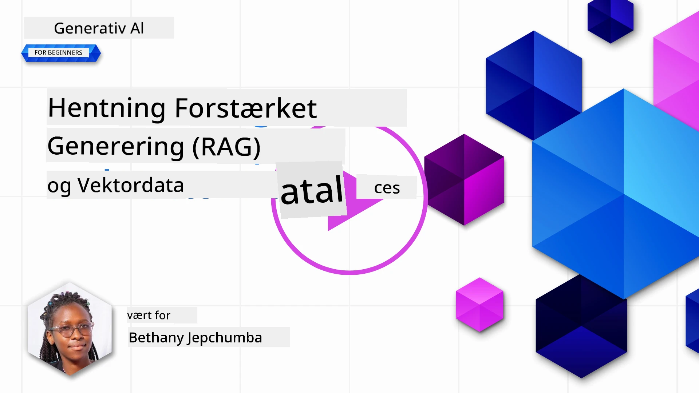
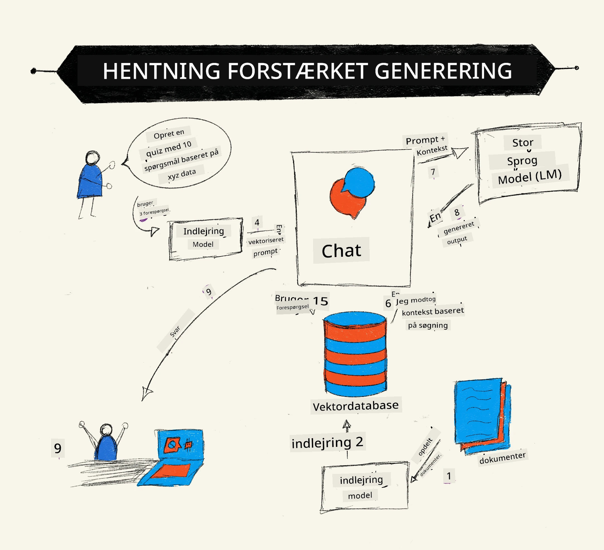
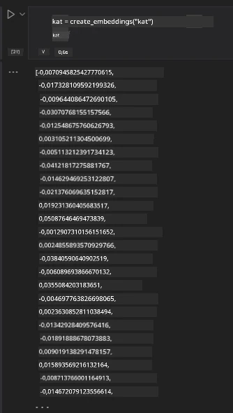

# Retrieval Augmented Generation (RAG) og vektordatabaser

[](https://youtu.be/4l8zhHUBeyI?si=BmvDmL1fnHtgQYkL)

I lektionen om søgeapplikationer lærte vi kort, hvordan man integrerer sine egne data i Large Language Models (LLMs). I denne lektion vil vi dykke dybere ned i begreberne omkring at forankre dine data i din LLM-applikation, processen bag og metoderne til opbevaring af data, herunder både embeddings og tekst.

> **Video Kommer Snart**

## Introduktion

I denne lektion vil vi dække følgende:

- En introduktion til RAG, hvad det er, og hvorfor det bruges i AI (kunstig intelligens).

- Forståelse af, hvad vektordatabaser er, og hvordan man opretter en til vores applikation.

- Et praktisk eksempel på, hvordan man integrerer RAG i en applikation.

## Læringsmål

Efter at have gennemført denne lektion vil du kunne:

- Forklar betydningen af RAG i datahentning og -behandling.

- Opsæt en RAG-applikation og funder en LLM med dine data

- Integrer effektivt RAG og vektordatabaser i LLM-applikationer.

## Vores scenario: forbedring af vores LLMs med vores egne data

Til denne lektion ønsker vi at tilføje vores egne noter til uddannelsesstartup'en, hvilket giver chatbotten mulighed for at få mere information om de forskellige emner. Ved at bruge de noter, vi har, vil eleverne være i stand til at studere bedre og forstå de forskellige emner, hvilket gør det nemmere at repetere til deres eksamener. For at skabe vores scenario vil vi bruge:

- `Azure OpenAI:` den LLM vi vil bruge til at skabe vores chatbot

- `AI for beginners' lektionen om neurale netværk`: dette bliver de data, vi forankrer vores LLM på

- `Azure AI Search` og `Azure Cosmos DB:` vektordatabaser til at gemme vores data og oprette en søgeindeks

Brugere vil kunne oprette øve-quizzer og repetitionsflashcards ud fra deres noter og opsummere disse noter til præcise oversigter. For at komme i gang, lad os se på, hvad RAG er, og hvordan det fungerer:

## Retrieval Augmented Generation (RAG)

En LLM-drevet chatbot behandler brugerforespørgsler for at generere svar. Den er designet til at være interaktiv og engagerer sig med brugere om en bred vifte af emner. Dog er dens svar begrænset til den kontekst, der er givet, og dens grundlæggende træningsdata. For eksempel har GPT-4 vidensafskæringen i september 2021, hvilket betyder, at den mangler kendskab til hændelser, der er sket efter denne periode. Desuden indeholder dataene, der bruges til at træne LLMs, ikke fortrolige oplysninger som personlige noter eller en virksomheds produktmanual.

### Hvordan RAGs (Retrieval Augmented Generation) fungerer



Forestil dig, at du vil udrulle en chatbot, der laver quizzer ud fra dine noter; du vil have brug for en forbindelse til vidensbasen. Her kommer RAG til undsætning. RAGs fungerer således:

- **Vidensbase:** Før indhentning skal disse dokumenter indlæses og forbehandles, typisk ved at bryde store dokumenter ned i mindre bidder, omdanne dem til tekstembeddings og gemme dem i en database.

- **Brugerforespørgsel:** brugeren stiller et spørgsmål

- **Indhentning:** Når en bruger stiller et spørgsmål, henter embeddingsmodellen relevant information fra vores vidensbase for at give mere kontekst, som inkorporeres i prompten.

- **Forstærket generering:** LLM'en forbedrer sit svar baseret på de hentede data. Det tillader, at det genererede svar ikke kun bygger på forudtrænede data men også relevant information fra den tilføjede kontekst. De hentede data bruges til at forstærke LLM’ens svar. LLM’en returnerer derefter et svar til brugerens spørgsmål.


RAG kombinerer en søger med en generator: forespørgslen konverteres til en vektor, matches mod dokumentindekset for at finde relevante tekstafsnit, og disse afsnit leveres som kontekst til en LLM, som genererer svaret. Søgeren og generatoren kan bruge forskellige modeller; RAG kræver ikke en encoder-decoder transformer.

To tilgange til implementering af RAG ifølge den foreslåede artikel: [Retrieval-Augmented Generation for Knowledge intensive NLP (natural language processing software) Tasks](https://arxiv.org/pdf/2005.11401.pdf?WT.mc_id=academic-105485-koreyst) er:

- **_RAG-Sequence_** hvor hentede dokumenter bruges til at forudsige det bedst mulige svar på en brugerforespørgsel

- **RAG-Token** hvor dokumenter bruges til at generere det næste token, og derefter hentes de for at besvare brugerens forespørgsel

### Hvorfor bruge RAGs?

- **Informationsrigdom:** sikrer at tekstsvar er opdaterede og aktuelle. Det forbedrer derfor præstationen på domænespecifikke opgaver ved at få adgang til den interne vidensbase.

- Reducerer fabrikation ved at bruge **verificerbare data** i vidensbasen for at give kontekst til brugerforespørgsler.

- Det er **omkostningseffektivt**, da de er mere økonomiske sammenlignet med at finjustere en LLM

## Oprettelse af en vidensbase

Vores applikation er baseret på vores personlige data, dvs. Neural Network-lektionen fra AI for Beginners-kurset.

### Vektordatabaser

En vektordatabase, i modsætning til traditionelle databaser, er en specialiseret database designet til at gemme, håndtere og søge i indlejrede vektorer. Den gemmer numeriske repræsentationer af dokumenter. At bryde data ned til numeriske embeddings gør det nemmere for vores AI-system at forstå og behandle dataene.

Fordi LLM'er har en grænse for antallet af input-token, deler vi dokumenter op i bidder, før vi embedder dem. Når en bruger stiller et spørgsmål, identificerer de embeddings, der er mest lig query'en, de relevante tekstbidder, som returneres med prompten. Opdeling i bidder reducerer også antallet af tokens, der sendes til LLM'en, og kan derfor reducere omkostningerne.

Nogle populære vektordatabaser inkluderer Azure Cosmos DB, Clarifyai, Pinecone, Chromadb, ScaNN, Qdrant og DeepLake. Du kan oprette en Azure Cosmos DB-model ved hjælp af Azure CLI med følgende kommando:

```bash
az login
az group create -n <resource-group-name> -l <location>
az cosmosdb create -n <cosmos-db-name> -r <resource-group-name>
az cosmosdb list-keys -n <cosmos-db-name> -g <resource-group-name>
```

### Fra tekst til embeddings

Før vi gemmer vores data, skal vi omdanne dem til vektor-embeddings, før de lagres i databasen. Hvis du arbejder med store dokumenter eller lange tekster, kan du opdele dem i bidder baseret på de spørgsmål, du forventer. Opdeling kan ske på sætningsniveau eller afsnitsniveau. Da opdeling udleder mening fra de omkringliggende ord, kan du tilføje noget anden kontekst til en bid, for eksempel ved at tilføje dokumentets titel eller inkludere noget tekst før eller efter bidet. Du kan opdele dataene som følger:

```python
def split_text(text, max_length, min_length):
    words = text.split()
    chunks = []
    current_chunk = []

    for word in words:
        current_chunk.append(word)
        if len(' '.join(current_chunk)) < max_length and len(' '.join(current_chunk)) > min_length:
            chunks.append(' '.join(current_chunk))
            current_chunk = []

    # Hvis den sidste del ikke nåede minimumslængden, skal den tilføjes alligevel
    if current_chunk:
        chunks.append(' '.join(current_chunk))

    return chunks
```

Når de er opdelte, kan vi så indlejre vores tekst ved hjælp af forskellige embeddingsmodeller. Nogle modeller, du kan bruge, inkluderer: word2vec, ada-002 fra OpenAI, Azure Computer Vision og mange flere. Valg af model afhænger af de sprog, du bruger, typen af indhold, der kodes (tekst/billeder/lyd), størrelsen af input, den kan kode, og længden af embedding-output.

Et eksempel på indlejret tekst ved brug af OpenAI’s `text-embedding-ada-002` model er:


## Indhentning og vektorsøgning

Når en bruger stiller et spørgsmål, omdanner retrieveren det til en vektor ved hjælp af forespørgselskoderen, hvorefter den søger gennem vores dokumentindeks efter relevante vektorer i dokumentet, der relaterer til inputtet. Når det er gjort, konverterer den både inputvektoren og dokumentvektorerne til tekst og sender det gennem LLM’en.

### Indhentning

Indhentning sker, når systemet forsøger hurtigt at finde de dokumenter fra indekset, der opfylder søgekriterierne. Målet med retrieveren er at få dokumenter, der skal bruges til at give kontekst og forankre LLM’en på dine data.

Der er flere måder at udføre søgning i vores database, såsom:

- **Søgeordssøgning** - bruges til tekstsøgninger

- **Vektorsøgning** - omdanner dokumenter fra tekst til vektorrepræsentationer ved hjælp af embeddingsmodeller, hvilket muliggør en **semantisk søgning** baseret på ords betydning. Indhentning foretages ved at forespørge de dokumenter, hvis vektorrepræsentationer er tættest på brugerens spørgsmål.

- **Hybrid** - en kombination af både søgeordssøgning og vektorsøgning.

En udfordring ved indhentning opstår, når der ikke findes noget lignende svar på forespørgslen i databasen; systemet vil da returnere den bedste information, det kan finde, men du kan bruge taktikker som at sætte maksimal afstand for relevans eller bruge hybridsøgning, der kombinerer både søgeord og vektorsøgning. I denne lektion vil vi bruge hybridsøgning, en kombination af både vektor- og søgeordssøgning. Vi vil gemme vores data i en dataframe med kolonner, der indeholder både bidderne og embeddings.

### Vektorsimilitet

Retrieveren vil søge gennem vidensdatabasen efter indlejringer, der ligger tæt på hinanden—de nærmeste naboer—da de repræsenterer tekster, der ligner hinanden. I dette scenarie, når en bruger indsender en forespørgsel, bliver den først indlejret og derefter matchet med lignende indlejringer. Det mest almindelige mål, der bruges til at sammenligne vektorlignende, er cosinuslignende, som er baseret på vinklen mellem to vektorer.

Andre metrikker, vi kan bruge til at måle lighed, inkluderer euklidisk afstand, som er den lige linje mellem vektorendepunkter, og prikprodukt, som måler summen af produkterne af tilsvarende elementer i to vektorer.

### Søgeindeks

Når vi foretager indhentning, skal vi bygge et søgeindeks for vores vidensbase, før vi udfører søgningen. Et indeks vil gemme vores embeddings og kan hurtigt hente de mest lignende bidder selv i en stor database. Vi kan oprette vores indeks lokalt ved hjælp af:

```python
from sklearn.neighbors import NearestNeighbors

embeddings = flattened_df['embeddings'].to_list()

# Opret søgeindekset
nbrs = NearestNeighbors(n_neighbors=5, algorithm='ball_tree').fit(embeddings)

# For at forespørge indekset kan du bruge kneighbors-metoden
distances, indices = nbrs.kneighbors(embeddings)
```

### Genrangering

Når du har forespurgt databasen, kan det være nødvendigt at sortere resultaterne ud fra relevans. En genrangerings-LLM bruger maskinlæring til at forbedre relevansen af søgeresultater ved at ordne dem fra mest relevant. Ved brug af Azure AI Search sker genrangering automatisk for dig ved hjælp af en semantisk genrangering. Et eksempel på hvordan genrangering fungerer med nærmeste naboer:

```python
# Find de mest lignende dokumenter
distances, indices = nbrs.kneighbors([query_vector])

index = []
# Udskriv de mest lignende dokumenter
for i in range(3):
    index = indices[0][i]
    for index in indices[0]:
        print(flattened_df['chunks'].iloc[index])
        print(flattened_df['path'].iloc[index])
        print(flattened_df['distances'].iloc[index])
    else:
        print(f"Index {index} not found in DataFrame")
```

## Sæt det hele sammen

Det sidste trin er at tilføje vores LLM i mixet for at kunne få svar, der er forankret i vores data. Vi kan implementere det som følger:

```python
user_input = "what is a perceptron?"

def chatbot(user_input):
    # Konverter spørgsmålet til en forespørgselsvektor
    query_vector = create_embeddings(user_input)

    # Find de mest lignende dokumenter
    distances, indices = nbrs.kneighbors([query_vector])

    # tilføj dokumenter til forespørgslen for at give kontekst
    history = []
    for index in indices[0]:
        history.append(flattened_df['chunks'].iloc[index])

    # kombiner historikken og brugerinput
    history.append(user_input)

    # opret et beskedobjekt
    messages=[
        {"role": "system", "content": "You are an AI assistant that helps with AI questions."},
        {"role": "user", "content": "\n\n".join(history) }
    ]

    # brug Responses API'en til at generere et svar
    response = client.responses.create(
        model="gpt-5-mini",
        max_output_tokens=800,
        input=messages,
        store=False,
    )

    return response.output_text

chatbot(user_input)
```

## Evaluering af vores applikation

### Evalueringsmetrikker

- Kvaliteten af leverede svar, som sikrer at det lyder naturligt, flydende og menneskelignende.

- Forankring af dataene: vurdering af, om svaret kom fra de leverede dokumenter

- Relevans: vurdering af om svaret matcher og relaterer til det stillede spørgsmål

- Flydendehed - om svaret giver grammatisk mening

## Brugstilfælde for brug af RAG (Retrieval Augmented Generation) og vektordatabaser

Der er mange forskellige brugssituationer, hvor RAG kan forbedre din app, for eksempel:

- Spørgsmål og svar: forankring af virksomhedens data til en chat, der kan bruges af medarbejdere til at stille spørgsmål.

- Anbefalingssystemer: hvor du kan oprette et system, der matcher de mest lignende værdier, f.eks. film, restauranter og mange flere.

- Chatbot-tjenester: du kan gemme chat-historik og personliggøre samtalen baseret på brugerdata.

- Billedsøgning baseret på vektor-embeddings, nyttigt ved billedgenkendelse og anomalidetektion.

## Resumé

Vi har dækket de grundlæggende områder af RAG fra tilføjelse af vores data til applikationen, brugerforespørgslen og output. For at forenkle oprettelsen af RAG kan du bruge frameworks som Semantic Kernel, LangChain eller AutoGen.

## Opgave

For at fortsætte din læring om Retrieval Augmented Generation (RAG) kan du bygge:

- Byg en front-end til applikationen ved hjælp af det framework, du foretrækker

- Brug et framework, enten LangChain eller Semantic Kernel, og genskab din applikation.

Tillykke med at have gennemført lektionen 👏.

## Læringen stopper ikke her, fortsæt rejsen

Efter at have gennemført denne lektion, tjek vores [Generative AI Learning collection](https://aka.ms/genai-collection?WT.mc_id=academic-105485-koreyst) for at fortsætte med at øge din viden om Generativ AI!

---

<!-- CO-OP TRANSLATOR DISCLAIMER START -->
**Ansvarsfraskrivelse**:
Dette dokument er blevet oversat ved hjælp af AI-oversættelsestjenesten [Co-op Translator](https://github.com/Azure/co-op-translator). Selvom vi bestræber os på nøjagtighed, skal du være opmærksom på, at automatiserede oversættelser kan indeholde fejl eller unøjagtigheder. Det originale dokument på dets oprindelige sprog bør betragtes som den autoritative kilde. For kritisk information anbefales professionel menneskelig oversættelse. Vi påtager os intet ansvar for misforståelser eller fejltolkninger, der opstår som følge af brugen af denne oversættelse.
<!-- CO-OP TRANSLATOR DISCLAIMER END -->