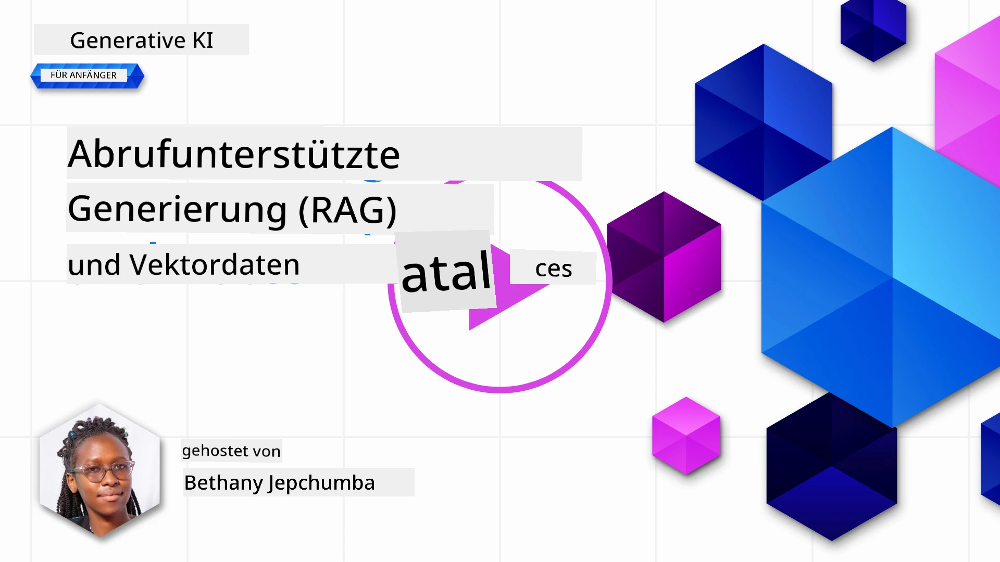
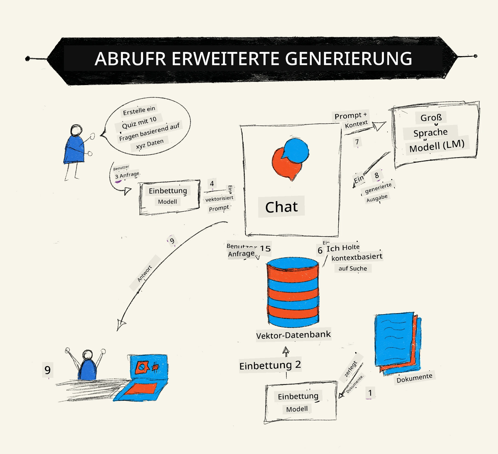
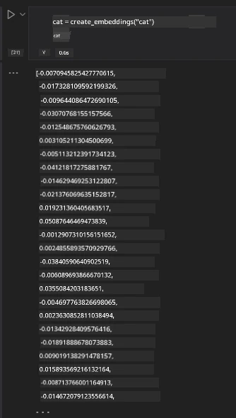

# Retrieval Augmented Generation (RAG) und Vektor-Datenbanken

[](https://youtu.be/4l8zhHUBeyI?si=BmvDmL1fnHtgQYkL)

In der Lektion zu Suchanwendungen haben wir kurz gelernt, wie Sie Ihre eigenen Daten in Large Language Models (LLMs) integrieren können. In dieser Lektion vertiefen wir die Konzepte der Verankerung Ihrer Daten in Ihrer LLM-Anwendung, die Mechanik des Prozesses und die Methoden zur Speicherung von Daten, einschließlich sowohl Embeddings als auch Text.

> **Video demnächst verfügbar**

## Einführung

In dieser Lektion behandeln wir Folgendes:

- Eine Einführung in RAG, was es ist und warum es in KI (künstlicher Intelligenz) verwendet wird.

- Verständnis, was Vektor-Datenbanken sind und wie man eine für unsere Anwendung erstellt.

- Ein praktisches Beispiel, wie man RAG in eine Anwendung integriert.

## Lernziele

Nach Abschluss dieser Lektion können Sie:

- Erklären Sie die Bedeutung von RAG bei der Datenabfrage und -verarbeitung.

- Richten Sie eine RAG-Anwendung ein und stützen Sie ein LLM auf Ihre Daten.

- Integrieren Sie RAG und Vektordatenbanken effektiv in LLM-Anwendungen.

## Unser Szenario: Unsere LLMs mit eigenen Daten verbessern

Für diese Lektion möchten wir eigene Notizen in das Bildungs-Startup einfügen, damit der Chatbot mehr Informationen zu verschiedenen Themen erhält. Mit den Notizen können Lernende besser lernen und die verschiedenen Themen verstehen, was das Wiederholen für ihre Prüfungen erleichtert. Für unser Szenario verwenden wir:

- `Azure OpenAI:` das LLM, das wir für unseren Chatbot verwenden

- `KI für Einsteiger` Lektion über Neuronale Netze: dies sind die Daten, auf denen wir unser LLM verankern

- `Azure AI Search` und `Azure Cosmos DB:` Vektor-Datenbank zum Speichern unserer Daten und Erstellen eines Suchindexes

Benutzer werden in der Lage sein, Übungsquizze und Wiederholungskarten aus ihren Notizen zu erstellen und diese Notizen in prägnante Übersichten zusammenzufassen. Um zu beginnen, schauen wir uns an, was RAG ist und wie es funktioniert:

## Retrieval Augmented Generation (RAG)

Ein LLM-betriebener Chatbot verarbeitet Benutzeranfragen, um Antworten zu generieren. Er ist darauf ausgelegt, interaktiv zu sein und mit Nutzern über eine Vielzahl von Themen zu kommunizieren. Seine Antworten sind jedoch auf den bereitgestellten Kontext und das grundlegende Trainingsmaterial beschränkt. Zum Beispiel hat GPT-4 einen Wissensstand bis September 2021, d.h. es fehlen Kenntnisse über Ereignisse, die nach diesem Zeitraum stattfanden. Zudem beinhaltet das Trainingsmaterial von LLMs keine vertraulichen Informationen wie persönliche Notizen oder Handbücher eines Unternehmens.

### Wie RAGs (Retrieval Augmented Generation) funktionieren



Angenommen, Sie möchten einen Chatbot bereitstellen, der Quiz aus Ihren Notizen erstellt, benötigen Sie eine Verbindung zur Wissensdatenbank. Hier kommt RAG zur Hilfe. RAGs funktionieren wie folgt:

- **Wissensdatenbank:** Vor der Abfrage müssen diese Dokumente aufgenommen und vorverarbeitet werden, typischerweise indem große Dokumente in kleinere Abschnitte aufgeteilt, in Text-Embeddings umgewandelt und in einer Datenbank gespeichert werden.

- **Benutzeranfrage:** Der Nutzer stellt eine Frage.

- **Abruf (Retrieval):** Wenn ein Nutzer eine Frage stellt, ruft das Embedding-Modell relevante Informationen aus unserer Wissensdatenbank ab, um mehr Kontext bereitzustellen, der in die Anfrage einfließt.

- **Erweiterte Generierung:** Das LLM verbessert seine Antwort basierend auf den abgerufenen Daten. Dadurch basiert die Antwort nicht nur auf vortrainierten Daten, sondern auch auf relevanten Informationen aus dem hinzugefügten Kontext. Die abgerufenen Daten werden genutzt, um die Antworten des LLM zu ergänzen. Das LLM gibt dann eine Antwort auf die Nutzerfrage zurück.


RAG kombiniert einen Retriever mit einem Generator: Die Abfrage wird in einen Vektor umgewandelt, mit dem Dokumentenindex abgeglichen, um relevante Textabschnitte zu finden, und diese Abschnitte werden einem LLM als Kontext zur Verfügung gestellt, das die Antwort generiert. Der Retriever und der Generator können unterschiedliche Modelle verwenden; RAG erfordert keinen Encoder-Decoder-Transformer.

Zwei Ansätze zur Implementierung von RAG gemäß der vorgeschlagenen Studie: [Retrieval-Augmented Generation for Knowledge intensive NLP (natural language processing software) Tasks](https://arxiv.org/pdf/2005.11401.pdf?WT.mc_id=academic-105485-koreyst) sind:

- **_RAG-Sequence_** verwendet abgerufene Dokumente, um die bestmögliche Antwort auf eine Nutzeranfrage vorherzusagen.

- **RAG-Token** verwendet Dokumente, um das nächste Token zu generieren, und ruft dann weitere Dokumente ab, um die Nutzerfrage zu beantworten.

### Warum sollte man RAGs verwenden?

- **Informationsfülle:** Stellt sicher, dass Textantworten aktuell und auf dem neuesten Stand sind. Dadurch wird die Leistung bei domänenspezifischen Aufgaben durch Zugriff auf die interne Wissensdatenbank verbessert.

- Reduziert Falschinformationen, indem **überprüfbare Daten** aus der Wissensdatenbank genutzt werden, um Kontext für Nutzeranfragen zu liefern.

- Es ist **kosteneffizient**, da es im Vergleich zur Feinabstimmung eines LLM wirtschaftlicher ist.

## Erstellen einer Wissensdatenbank

Unsere Anwendung basiert auf unseren persönlichen Daten, d.h. der Lektion über neuronale Netzwerke aus dem AI for Beginners Lehrplan.

### Vektor-Datenbanken

Eine Vektor-Datenbank ist im Gegensatz zu traditionellen Datenbanken eine spezialisierte Datenbank, die darauf ausgelegt ist, eingebettete Vektoren zu speichern, zu verwalten und zu durchsuchen. Sie speichert numerische Repräsentationen von Dokumenten. Die Zerlegung von Daten in numerische Embeddings erleichtert es unserem KI-System, die Daten zu verstehen und zu verarbeiten.

Da LLMs eine Begrenzung der Eingabetoken haben, teilen wir Dokumente vor dem Einbetten in Abschnitte auf. Wenn ein Nutzer eine Frage stellt, identifizieren die den Suchanfragen am ähnlichsten Embeddings die relevanten Textabschnitte, die zusammen mit dem Prompt zurückgegeben werden. Das Aufteilen in Abschnitte reduziert auch die Anzahl der Tokens, die an das LLM übergeben werden, und kann somit die Kosten senken.

Einige beliebte Vektor-Datenbanken sind Azure Cosmos DB, Clarifyai, Pinecone, Chromadb, ScaNN, Qdrant und DeepLake. Sie können ein Azure Cosmos DB-Modell mit Azure CLI mit folgendem Befehl erstellen:

```bash
az login
az group create -n <resource-group-name> -l <location>
az cosmosdb create -n <cosmos-db-name> -r <resource-group-name>
az cosmosdb list-keys -n <cosmos-db-name> -g <resource-group-name>
```

### Vom Text zu Embeddings

Bevor wir unsere Daten speichern, müssen wir sie in Vektor-Embeddings umwandeln, bevor sie in der Datenbank gespeichert werden. Wenn Sie mit großen Dokumenten oder langen Texten arbeiten, können Sie diese basierend auf den erwarteten Abfragen in Abschnitte (Chunks) unterteilen. Das Chunking kann auf Satz- oder Absatzebene erfolgen. Da Chunks ihre Bedeutung aus den umgebenden Wörtern ableiten, können Sie einem Chunk zusätzlichen Kontext hinzufügen, z.B. durch Hinzufügen des Dokumenttitels oder durch Einfügen einiger Texte vor oder nach dem Chunk. Sie können die Daten wie folgt chunkieren:

```python
def split_text(text, max_length, min_length):
    words = text.split()
    chunks = []
    current_chunk = []

    for word in words:
        current_chunk.append(word)
        if len(' '.join(current_chunk)) < max_length and len(' '.join(current_chunk)) > min_length:
            chunks.append(' '.join(current_chunk))
            current_chunk = []

    # Wenn das letzte Stück nicht die Mindestlänge erreicht hat, füge es trotzdem hinzu
    if current_chunk:
        chunks.append(' '.join(current_chunk))

    return chunks
```

Sobald die Daten aufgeteilt sind, können wir unseren Text mit verschiedenen Embedding-Modellen einbetten. Einige Modelle, die Sie verwenden können, sind: word2vec, ada-002 von OpenAI, Azure Computer Vision und viele mehr. Die Auswahl eines Modells hängt von den verwendeten Sprachen, der Art des codierten Inhalts (Text/Bilder/Audio), der Größe der Eingabe und der Länge des Embedding-Ausgangs ab.

Ein Beispiel für eingebetteten Text mit dem OpenAI `text-embedding-ada-002` Modell ist:


## Abruf und Vektorsuche

Wenn ein Nutzer eine Frage stellt, wandelt der Retriever diese mit dem Query-Encoder in einen Vektor um, sucht dann in unserem Dokumentensuchindex nach relevanten Vektoren im Dokument, die zur Eingabe passen. Anschließend werden sowohl der Eingabevektor als auch die Dokumentenvektoren in Text umgewandelt und durch das LLM geleitet.

### Abruf

Der Abruf erfolgt, wenn das System versucht, schnell die Dokumente aus dem Index zu finden, die die Suchkriterien erfüllen. Das Ziel des Retrievers ist es, Dokumente zu erhalten, die verwendet werden, um Kontext bereitzustellen und das LLM auf Ihre Daten zu verankern.

Es gibt mehrere Möglichkeiten, innerhalb unserer Datenbank zu suchen, z.B.:

- **Schlüsselwortsuche** - verwendet für Textsuchen

- **Vektorsuche** - wandelt Dokumente von Text in Vektor-Repräsentationen mit Embedding-Modellen um und ermöglicht so eine **semantische Suche** anhand der Bedeutung von Wörtern. Der Abruf erfolgt durch Abfragen der Dokumente, deren Vektor-Repräsentationen der Nutzerfrage am nächsten sind.

- **Hybrid** - eine Kombination aus Schlüsselwort- und Vektorsuche.

Eine Herausforderung beim Abruf entsteht, wenn keine ähnliche Antwort in der Datenbank vorhanden ist; das System gibt dann die bestmöglichen Informationen zurück. Sie können jedoch Taktiken anwenden, wie z.B. die maximale Distanz für Relevanz festzulegen oder Hybridsuche zu verwenden, die sowohl Schlüsselwort- als auch Vektorsuche kombiniert. In dieser Lektion verwenden wir Hybridsuche, eine Kombination aus Vektor- und Schlüsselwortsuche. Wir speichern unsere Daten in einem Dataframe mit Spalten für die Chunks sowie für Embeddings.

### Vektorähnlichkeit

Der Retriever sucht in der Wissensdatenbank nach Einbettungen, die nahe beieinander liegen – den nächsten Nachbarn –, da diese Texte darstellen, die ähnlich sind. In diesem Szenario wird bei einer Benutzeranfrage diese zuerst eingebettet und dann mit ähnlichen Einbettungen abgeglichen. Die am häufigsten verwendete Messgröße zur Bewertung der Vektorähnlichkeit ist die Kosinusähnlichkeit, die auf dem Winkel zwischen zwei Vektoren basiert.

Andere Metriken, die wir zur Messung der Ähnlichkeit verwenden können, umfassen die euklidische Distanz, die die gerade Linie zwischen den Endpunkten von Vektoren ist, und das Skalarprodukt, das die Summe der Produkte entsprechender Elemente in zwei Vektoren misst.

### Suchindex

Für den Abruf müssen wir einen Suchindex für unsere Wissensdatenbank erstellen, bevor wir die Suche durchführen. Ein Index speichert unsere Embeddings und kann auch in einer großen Datenbank die ähnlichsten Chunks schnell abrufen. Wir können unseren Index lokal erstellen mit:

```python
from sklearn.neighbors import NearestNeighbors

embeddings = flattened_df['embeddings'].to_list()

# Erstelle den Suchindex
nbrs = NearestNeighbors(n_neighbors=5, algorithm='ball_tree').fit(embeddings)

# Um den Index abzufragen, können Sie die Methode kneighbors verwenden
distances, indices = nbrs.kneighbors(embeddings)
```

### Neuanordnung (Re-ranking)

Nach der Abfrage der Datenbank müssen die Ergebnisse eventuell von der relevantesten abwärts sortiert werden. Ein Re-Ranking-LLM verwendet Machine Learning, um die Relevanz der Suchergebnisse zu verbessern, indem sie von der relevantesten geordnet werden. Mit Azure AI Search erfolgt das Re-Ranking automatisch mit einem semantischen Re-Ranker. Ein Beispiel, wie das Re-Ranking mit nächsten Nachbarn funktioniert:

```python
# Find the most similar documents
distances, indices = nbrs.kneighbors([query_vector])

# Print the three most similar documents with their distance to the question
for distance, index in zip(distances[0][:3], indices[0][:3]):
    print(flattened_df['chunks'].iloc[index])
    print(flattened_df['path'].iloc[index])
    print(distance)
```

## Alles zusammenführen

Der letzte Schritt ist, unser LLM hinzuzufügen, um Antworten zu erhalten, die auf unseren Daten basieren. Wir können dies wie folgt implementieren:

```python
user_input = "what is a perceptron?"

def chatbot(user_input):
    # Konvertieren Sie die Frage in einen Abfrage-Vektor
    query_vector = create_embeddings(user_input)

    # Finden Sie die ähnlichsten Dokumente
    distances, indices = nbrs.kneighbors([query_vector])

    # Fügen Sie Dokumente zur Abfrage hinzu, um Kontext bereitzustellen
    history = []
    for index in indices[0]:
        history.append(flattened_df['chunks'].iloc[index])

    # Kombinieren Sie den Verlauf und die Benutzereingabe
    history.append(user_input)

    # Erstellen Sie ein Nachrichtenobjekt
    messages=[
        {"role": "system", "content": "You are an AI assistant that helps with AI questions."},
        {"role": "user", "content": "\n\n".join(history) }
    ]

    # Verwenden Sie die Responses-API, um eine Antwort zu generieren
    response = client.responses.create(
        model="gpt-5-mini",
        max_output_tokens=800,
        input=messages,
        store=False,
    )

    return response.output_text

chatbot(user_input)
```

## Unsere Anwendung bewerten

### Bewertungsmetriken

- Qualität der gelieferten Antworten, damit sie natürlich, flüssig und menschenähnlich klingen

- Verankerung der Daten: Bewertung, ob die Antwort aus den bereitgestellten Dokumenten stammt

- Relevanz: Bewertung, ob die Antwort mit der gestellten Frage übereinstimmt und dazu in Beziehung steht

- Flüssigkeit - ob die Antwort grammatikalisch sinnvoll ist

## Anwendungsfälle für RAG (Retrieval Augmented Generation) und Vektor-Datenbanken

Es gibt viele verschiedene Anwendungsfälle, in denen RAG Ihre App verbessern kann, wie zum Beispiel:

- Frage- und Antwortsysteme: Ihre Unternehmensdaten an einen Chat binden, der von Mitarbeitern zur Fragestellung genutzt werden kann.

- Empfehlungssysteme: Erstellen eines Systems, das die ähnlichsten Werte z.B. Filme, Restaurants und vieles mehr abgleicht.

- Chatbot-Dienste: Chatverlauf speichern und das Gespräch basierend auf Benutzerdaten personalisieren.

- Bildsuche basierend auf Vektor-Embeddings, nützlich bei Bilderkennung und Anomalieerkennung.

## Zusammenfassung

Wir haben die grundlegenden Bereiche von RAG behandelt, vom Hinzufügen unserer Daten zur Anwendung über die Benutzeranfrage bis hin zur Ausgabe. Um die Erstellung von RAG zu vereinfachen, können Sie Frameworks wie Semantic Kernel, LangChain oder AutoGen verwenden.

## Aufgabe

Um Ihre Kenntnisse in Retrieval Augmented Generation (RAG) zu vertiefen, können Sie:

- Eine Benutzeroberfläche für die Anwendung mit dem Framework Ihrer Wahl erstellen.

- Ein Framework, entweder LangChain oder Semantic Kernel, verwenden und Ihre Anwendung neu erstellen.

Herzlichen Glückwunsch zum Abschluss der Lektion 👏.

## Lernen hört hier nicht auf, setzen Sie Ihre Reise fort

Nach Abschluss dieser Lektion sehen Sie sich unsere [Generative AI Learning collection](https://aka.ms/genai-collection?WT.mc_id=academic-105485-koreyst) an, um Ihr Wissen zu Generativer KI weiter zu vertiefen!

---

<!-- CO-OP TRANSLATOR DISCLAIMER START -->
**Haftungsausschluss**:
Dieses Dokument wurde mit dem KI-Übersetzungsdienst [Co-op Translator](https://github.com/Azure/co-op-translator) übersetzt. Obwohl wir uns um Genauigkeit bemühen, beachten Sie bitte, dass automatisierte Übersetzungen Fehler oder Ungenauigkeiten enthalten können. Das Originaldokument in seiner Ursprungssprache gilt als maßgebliche Quelle. Bei kritischen Informationen wird eine professionelle menschliche Übersetzung empfohlen. Wir übernehmen keine Haftung für Missverständnisse oder Fehlinterpretationen, die aus der Verwendung dieser Übersetzung entstehen.
<!-- CO-OP TRANSLATOR DISCLAIMER END -->