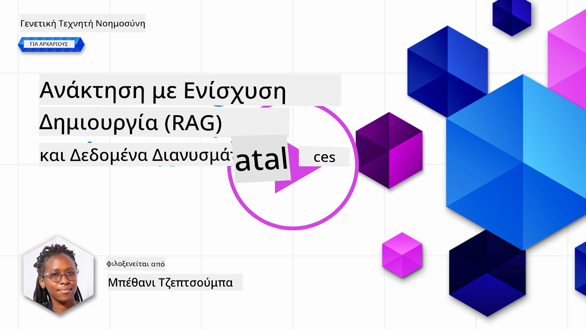
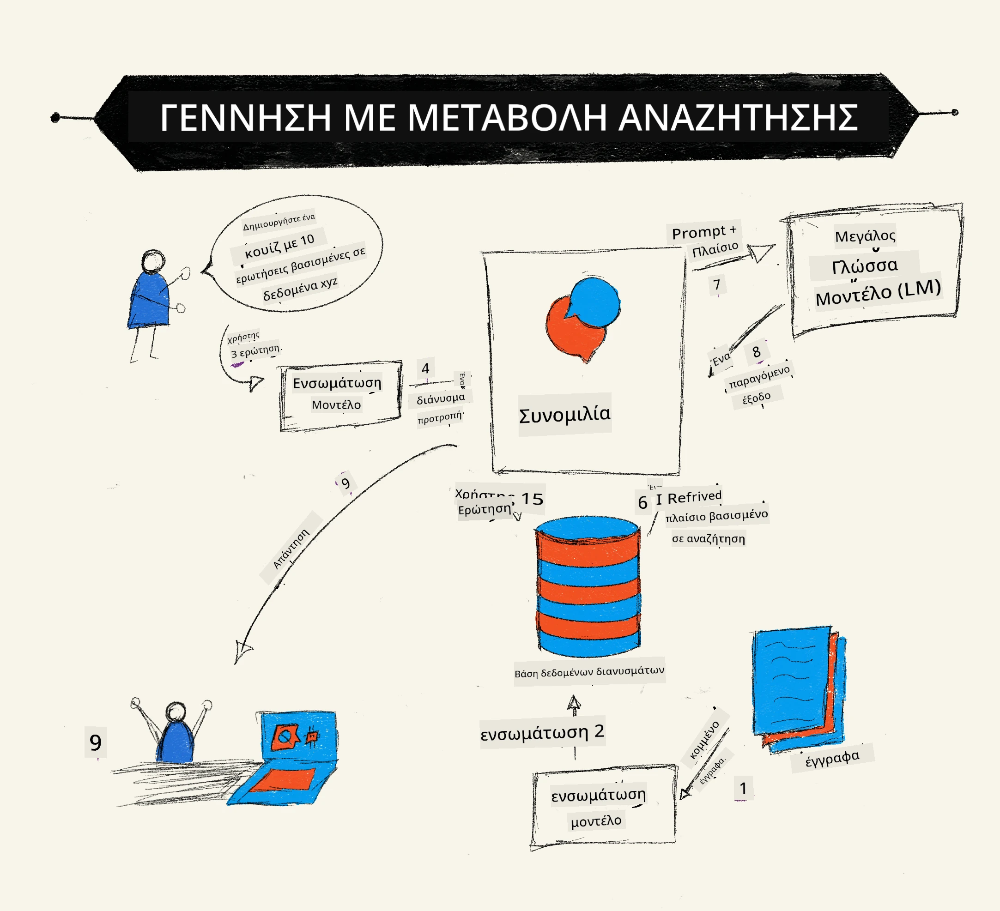
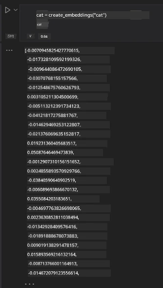

# Ανάκτηση Ενισχυμένης Γενιάς (RAG) και Βάσεις Δεδομένων Διανυσμάτων

[](https://youtu.be/4l8zhHUBeyI?si=BmvDmL1fnHtgQYkL)

Στο μάθημα εφαρμογών αναζήτησης, μάθαμε σύντομα πώς να ενσωματώνουμε τα δικά μας δεδομένα στα Μεγάλα Μοντέλα Γλώσσας (LLMs). Σε αυτό το μάθημα, θα εμβαθύνουμε περαιτέρω στις έννοιες της θεμελίωσης των δεδομένων σας στην εφαρμογή LLM σας, τους μηχανισμούς της διαδικασίας και τις μεθόδους αποθήκευσης δεδομένων, συμπεριλαμβανομένων τόσο των ενσωματώσεων όσο και του κειμένου.

> **Βίντεο Έρχεται Σύντομα**

## Εισαγωγή

Σε αυτό το μάθημα θα καλύψουμε τα εξής:

- Μια εισαγωγή στο RAG, τι είναι και γιατί χρησιμοποιείται στην ΤΝ (τεχνητή νοημοσύνη).

- Κατανόηση τι είναι οι βάσεις δεδομένων διανυσμάτων και δημιουργία μίας για την εφαρμογή μας.

- Ένα πρακτικό παράδειγμα για το πώς να ενσωματώσετε το RAG σε μια εφαρμογή.

## Στόχοι Μάθησης

Μετά την ολοκλήρωση αυτού του μαθήματος, θα μπορείτε να:

- Εξηγήστε τη σημασία του RAG στην ανάκτηση και επεξεργασία δεδομένων.

- Δημιουργήστε μια εφαρμογή RAG και βασίστε ένα LLM με τα δεδομένα σας

- Ενσωματώστε αποτελεσματικά το RAG και τις βάσεις δεδομένων διανυσμάτων σε εφαρμογές LLM.

## Το Σενάριό μας: ενίσχυση των LLM μας με τα δικά μας δεδομένα

Για αυτό το μάθημα, θέλουμε να προσθέσουμε τις δικές μας σημειώσεις στην εκπαιδευτική νεοσύστατη επιχείρηση, η οποία επιτρέπει στο chatbot να λαμβάνει περισσότερες πληροφορίες για τα διαφορετικά θέματα. Χρησιμοποιώντας τις σημειώσεις που έχουμε, οι μαθητές θα μπορούν να μελετήσουν καλύτερα και να κατανοήσουν τα διάφορα θέματα, καθιστώντας πιο εύκολη την επανάληψη για τις εξετάσεις τους. Για να δημιουργήσουμε το σενάριό μας, θα χρησιμοποιήσουμε:

- `Azure OpenAI:` το LLM που θα χρησιμοποιήσουμε για να δημιουργήσουμε το chatbot μας

- `Μάθημα 'ΤΝ για αρχάριους' στα Νευρωνικά Δίκτυα`: αυτά θα είναι τα δεδομένα στα οποία θα θεμελιώσουμε το LLM μας

- `Azure AI Search` και `Azure Cosmos DB:` βάση δεδομένων διανυσμάτων για αποθήκευση των δεδομένων μας και δημιουργία ευρετηρίου αναζήτησης

Οι χρήστες θα μπορούν να δημιουργούν πρακτικά κουίζ και επαναληπτικές κάρτες από τις σημειώσεις τους και να συνοψίζουν αυτές τις σημειώσεις σε συνοπτικές επισκοπήσεις. Για να ξεκινήσουμε, ας δούμε τι είναι το RAG και πώς λειτουργεί:

## Ανάκτηση Ενισχυμένης Γενιάς (RAG)

Ένα chatbot που υποστηρίζεται από LLM επεξεργάζεται τις εντολές των χρηστών για να δημιουργήσει απαντήσεις. Σχεδιάζεται να είναι διαδραστικό και να αλληλεπιδρά με τους χρήστες σε ένα ευρύ φάσμα θεμάτων. Ωστόσο, οι απαντήσεις του περιορίζονται στο πλαίσιο που παρέχεται και στα θεμελιώδη δεδομένα εκπαίδευσής του. Για παράδειγμα, η γνώση του GPT-4 είναι έως τον Σεπτέμβριο 2021, που σημαίνει ότι δεν γνωρίζει γεγονότα που συνέβησαν μετά από αυτή την περίοδο. Επιπλέον, τα δεδομένα που χρησιμοποιούνται για να εκπαιδεύσουν τα LLM αποκλείουν εμπιστευτικές πληροφορίες όπως προσωπικές σημειώσεις ή εγχειρίδιο προϊόντων μιας εταιρείας.

### Πώς λειτουργούν τα RAG (Retrieval Augmented Generation)



Ας υποθέσουμε ότι θέλετε να υλοποιήσετε ένα chatbot που δημιουργεί κουίζ από τις σημειώσεις σας, θα χρειαστείτε σύνδεση με τη βάση γνώσης. Εδώ έρχεται το RAG στη διάσωση. Τα RAG λειτουργούν ως εξής:

- **Βάση γνώσης:** Πριν από την ανάκτηση, αυτά τα έγγραφα πρέπει να εισαχθούν και να προεπεξεργαστούν, συνήθως διαχωρίζοντας μεγάλα έγγραφα σε μικρότερα κομμάτια, μετατρέποντας τα σε ενσωματώσεις κειμένου και αποθηκεύοντάς τα σε μια βάση δεδομένων.

- **Ερώτηση Χρήστη:** ο χρήστης κάνει μια ερώτηση

- **Ανάκτηση:** Όταν ο χρήστης κάνει μια ερώτηση, το μοντέλο ενσωμάτωσης ανακτά σχετικές πληροφορίες από τη βάση γνώσης μας για να παράσχει περισσότερο πλαίσιο που ενσωματώνεται στην εντολή.

- **Ενισχυμένη Γενιά:** το LLM βελτιώνει την απάντησή του βάσει των ανακτηθέντων δεδομένων. Αυτό επιτρέπει η παραγόμενη απάντηση να βασίζεται όχι μόνο σε προεκπαιδευμένα δεδομένα αλλά και σε σχετικές πληροφορίες από το πρόσθετο πλαίσιο. Τα ανακτηθέντα δεδομένα χρησιμοποιούνται για την ενίσχυση των απαντήσεων του LLM. Το LLM στη συνέχεια επιστρέφει απάντηση στην ερώτηση του χρήστη.


Το RAG συνδυάζει έναν αναζητητή με έναν γεννήτορα: το ερώτημα μετατρέπεται σε διάνυσμα, αντιστοιχίζεται στον ευρετήριο εγγράφων για να βρεθούν σχετικά κομμάτια κειμένου, και αυτά τα κομμάτια παρέχονται ως πλαίσιο σε ένα LLM, το οποίο παράγει την απάντηση. Ο αναζητητής και ο γεννήτορας μπορεί να χρησιμοποιούν διαφορετικά μοντέλα· το RAG δεν απαιτεί μετασχηματιστή κωδικοποιητή-αποκωδικοποιητή.

Δύο προσεγγίσεις κατά την υλοποίηση του RAG σύμφωνα με την προτεινόμενη εργασία: [Retrieval-Augmented Generation for Knowledge intensive NLP (natural language processing software) Tasks](https://arxiv.org/pdf/2005.11401.pdf?WT.mc_id=academic-105485-koreyst) είναι:

- **_RAG-Sequence_** που χρησιμοποιεί ανακτημένα έγγραφα για να προβλέψει την καλύτερη δυνατή απάντηση σε μια ερώτηση χρήστη

- **RAG-Token** που χρησιμοποιεί έγγραφα για να παραγάγει τον επόμενο τόκεν, και στη συνέχεια τα ανακτά για να απαντήσει στην ερώτηση του χρήστη

### Γιατί να χρησιμοποιήσετε RAG;

- **Πλούτος πληροφοριών:** εξασφαλίζει ότι οι απαντήσεις κειμένου είναι ενημερωμένες και τρέχουσες. Επομένως, βελτιώνει την απόδοση σε συγκεκριμένες εργασίες τομέα με την πρόσβαση στη βάση γνώσης.

- Μειώνει την κατασκευή ψευδών απαντήσεων χρησιμοποιώντας **επαληθεύσιμα δεδομένα** στη βάση γνώσης για να παρέχει πλαίσιο στις ερωτήσεις των χρηστών.

- Είναι **οικονομικά αποδοτικό** αφού είναι πιο οικονομικό από το να κάνετε fine-tuning ενός LLM

## Δημιουργία βάσης γνώσης

Η εφαρμογή μας βασίζεται στα προσωπικά μας δεδομένα, δηλαδή το μάθημα Νευρωνικών Δικτύων από το πρόγραμμα σπουδών AI για Αρχάριους.

### Βάσεις Δεδομένων Διανυσμάτων

Μια βάση δεδομένων διανυσμάτων, σε αντίθεση με τις παραδοσιακές βάσεις δεδομένων, είναι μια εξειδικευμένη βάση σχεδιασμένη να αποθηκεύει, να διαχειρίζεται και να αναζητά ενσωματωμένα διανύσματα. Αποθηκεύει αριθμητικές αναπαραστάσεις εγγράφων. Η διάσπαση των δεδομένων σε αριθμητικές ενσωματώσεις διευκολύνει το σύστημα ΤΝ να κατανοήσει και να επεξεργαστεί τα δεδομένα.

Επειδή τα LLM έχουν όριο στον αριθμό των εισερχόμενων τοκενών, διαιρούμε τα έγγραφα σε τμήματα πριν από την ενσωμάτωσή τους. Όταν ένας χρήστης θέτει μια ερώτηση, οι ενσωματώσεις που είναι πιο παρόμοιες με το ερώτημα εντοπίζουν τα σχετικά τμήματα κειμένου, τα οποία επιστρέφονται μαζί με το prompt. Η διαίρεση σε τμήματα επίσης μειώνει τον αριθμό των τοκενών που περνούν στο LLM και συνεπώς μπορεί να μειώσει το κόστος.

Κάποιες δημοφιλείς βάσεις δεδομένων διανυσμάτων περιλαμβάνουν Azure Cosmos DB, Clarifyai, Pinecone, Chromadb, ScaNN, Qdrant και DeepLake. Μπορείτε να δημιουργήσετε ένα μοντέλο Azure Cosmos DB χρησιμοποιώντας το Azure CLI με την ακόλουθη εντολή:

```bash
az login
az group create -n <resource-group-name> -l <location>
az cosmosdb create -n <cosmos-db-name> -r <resource-group-name>
az cosmosdb list-keys -n <cosmos-db-name> -g <resource-group-name>
```

### Από κείμενο σε ενσωματώσεις

Πριν αποθηκεύσουμε τα δεδομένα μας, θα χρειαστεί να τα μετατρέψουμε σε διανυσματικές ενσωματώσεις πριν αποθηκευτούν στη βάση δεδομένων. Αν εργάζεστε με μεγάλα έγγραφα ή μακροσκελή κείμενα, μπορείτε να τα χωρίσετε σε κομμάτια με βάση τις ερωτήσεις που αναμένετε. Η διαίρεση μπορεί να γίνει σε επίπεδο προτάσεως ή παραγράφου. Καθώς η διαίρεση αντλεί τις έννοιες από τις λέξεις γύρω τους, μπορείτε να προσθέσετε κάποιο άλλο πλαίσιο σε ένα κομμάτι, για παράδειγμα, προσθέτοντας τον τίτλο του εγγράφου ή συμπεριλαμβάνοντας κείμενο πριν ή μετά το κομμάτι. Μπορείτε να χωρίσετε τα δεδομένα ως εξής:

```python
def split_text(text, max_length, min_length):
    words = text.split()
    chunks = []
    current_chunk = []

    for word in words:
        current_chunk.append(word)
        if len(' '.join(current_chunk)) < max_length and len(' '.join(current_chunk)) > min_length:
            chunks.append(' '.join(current_chunk))
            current_chunk = []

    # Εάν το τελευταίο κομμάτι δεν έφτασε το ελάχιστο μήκος, προσθέστε το ούτως ή άλλως
    if current_chunk:
        chunks.append(' '.join(current_chunk))

    return chunks
```

Μόλις χωριστεί, μπορούμε στη συνέχεια να ενσωματώσουμε το κείμενό μας χρησιμοποιώντας διάφορα μοντέλα ενσωμάτωσης. Μερικά μοντέλα που μπορείτε να χρησιμοποιήσετε περιλαμβάνουν: word2vec, ada-002 της OpenAI, Azure Computer Vision και πολλά ακόμα. Η επιλογή μοντέλου εξαρτάται από τις γλώσσες που χρησιμοποιείτε, τον τύπο περιεχομένου που κωδικοποιείται (κείμενο/εικόνες/ήχος), το μέγεθος εισόδου που μπορεί να κωδικοποιήσει και το μήκος της εξόδου ενσωμάτωσης.

Ένα παράδειγμα ενσωματωμένου κειμένου χρησιμοποιώντας το μοντέλο `text-embedding-ada-002` της OpenAI είναι:


## Ανάκτηση και Αναζήτηση Διανυσμάτων

Όταν ένας χρήστης κάνει μια ερώτηση, ο αναζητητής τη μετατρέπει σε διάνυσμα χρησιμοποιώντας τον κωδικοποιητή ερωτήσεων, στη συνέχεια ψάχνει μέσα στο ευρετήριο αναζήτησης εγγράφων για σχετικά διανύσματα που συνδέονται με την είσοδο. Μόλις γίνει αυτό, μετατρέπει τόσο το εισαγόμενο διάνυσμα όσο και τα διανύσματα εγγράφων σε κείμενο και τα περνά στο LLM.

### Ανάκτηση

Η ανάκτηση συμβαίνει όταν το σύστημα προσπαθεί γρήγορα να βρει τα έγγραφα από το ευρετήριο που ικανοποιούν τα κριτήρια αναζήτησης. Ο στόχος του αναζητητή είναι να βρει έγγραφα που θα χρησιμοποιηθούν για να παρέχουν πλαίσιο και να θεμελιώσουν το LLM στα δεδομένα σας.

Υπάρχουν αρκετοί τρόποι για να πραγματοποιήσουμε αναζήτηση στη βάση δεδομένων μας, όπως:

- **Αναζήτηση με λέξεις-κλειδιά** - χρησιμοποιείται για αναζητήσεις κειμένου

- **Αναζήτηση διανυσμάτων** - μετατρέπει έγγραφα από κείμενο σε διανυσματικές αναπαραστάσεις με χρήση μοντέλων ενσωμάτωσης, επιτρέποντας **σημασιολογική αναζήτηση** χρησιμοποιώντας τη σημασία των λέξεων. Η ανάκτηση γίνεται ζητώντας τα έγγραφα των οποίων οι αναπαραστάσεις διανυσμάτων είναι πιο κοντά στην ερώτηση του χρήστη.

- **Υβριδική** - συνδυασμός τόσο αναζήτησης με λέξεις-κλειδιά όσο και αναζήτησης με διανύσματα.

Μια πρόκληση με την ανάκτηση είναι όταν δεν υπάρχει παρόμοια απάντηση στην ερώτηση στη βάση δεδομένων, το σύστημα τότε επιστρέφει τις καλύτερες πληροφορίες που μπορεί να βρει, ωστόσο, μπορείτε να χρησιμοποιήσετε τακτικές όπως να ορίσετε τη μέγιστη απόσταση για συνάφεια ή να χρησιμοποιήσετε υβριδική αναζήτηση που συνδυάζει αναζήτηση με λέξεις-κλειδιά και διανύσματα. Σε αυτό το μάθημα θα χρησιμοποιήσουμε υβριδική αναζήτηση, συνδυασμό και των δύο. Θα αποθηκεύσουμε τα δεδομένα μας σε dataframe με στήλες που περιέχουν τα κομμάτια καθώς και τις ενσωματώσεις.

### Ομοιότητα Διανυσμάτων

Ο αναζητητής θα ψάξει στη βάση γνώσεων για ενσωματώσεις που βρίσκονται κοντά μεταξύ τους—τους γείτονες που είναι πιο κοντινοί—καθώς αντιπροσωπεύουν κείμενα που είναι όμοια. Σε αυτό το σενάριο, όταν ένας χρήστης υποβάλλει μια ερώτηση, αυτή πρώτα ενσωματώνεται και στη συνέχεια αντιστοιχίζεται με παρόμοιες ενσωματώσεις. Η πιο κοινή μέτρηση που χρησιμοποιείται για τη σύγκριση ομοιότητας των διανυσμάτων είναι η συνημίτονο της ομοιότητας, η οποία βασίζεται στη γωνία μεταξύ δύο διανυσμάτων.

Άλλες μετρικές που μπορούμε να χρησιμοποιήσουμε για να μετρήσουμε την ομοιότητα περιλαμβάνουν την ευκλείδεια απόσταση, που είναι η ευθεία γραμμή μεταξύ των άκρων ενός διανύσματος, και το εσωτερικό γινόμενο, που μετρά το άθροισμα των γινομένων των αντίστοιχων στοιχείων σε δύο διανύσματα.

### Ευρετήριο αναζήτησης

Κατά την ανάκτηση, θα χρειαστεί να δημιουργήσουμε ευρετήριο αναζήτησης για τη βάση γνώσης μας πριν πραγματοποιήσουμε την αναζήτηση. Ένα ευρετήριο θα αποθηκεύσει τις ενσωματώσεις μας και θα μπορεί γρήγορα να ανακτήσει τα πιο παρόμοια κομμάτια ακόμα και σε μια μεγάλη βάση δεδομένων. Μπορούμε να δημιουργήσουμε το ευρετήριό μας τοπικά χρησιμοποιώντας:

```python
from sklearn.neighbors import NearestNeighbors

embeddings = flattened_df['embeddings'].to_list()

# Δημιουργήστε το ευρετήριο αναζήτησης
nbrs = NearestNeighbors(n_neighbors=5, algorithm='ball_tree').fit(embeddings)

# Για να κάνετε ερώτηση στο ευρετήριο, μπορείτε να χρησιμοποιήσετε τη μέθοδο kneighbors
distances, indices = nbrs.kneighbors(embeddings)
```

### Ανακατάταξη (Re-ranking)

Μόλις κάνετε ερώτηση στη βάση δεδομένων, ίσως χρειαστεί να ταξινομήσετε τα αποτελέσματα ξεκινώντας από τα πιο σχετικά. Ένα reranking LLM χρησιμοποιεί Μηχανική Μάθηση για να βελτιώσει τη συνάφεια των αποτελεσμάτων αναζήτησης παραγγέλνοντάς τα από τα πιο σχετικά. Χρησιμοποιώντας το Azure AI Search, η ανακατάταξη γίνεται αυτόματα για εσάς χρησιμοποιώντας έναν σημασιολογικό επαναταξινομητή. Ένα παράδειγμα του πώς λειτουργεί η ανακατάταξη χρησιμοποιώντας τους πλησιέστερους γείτονες:

```python
# Find the most similar documents
distances, indices = nbrs.kneighbors([query_vector])

# Print the three most similar documents with their distance to the question
for distance, index in zip(distances[0][:3], indices[0][:3]):
    print(flattened_df['chunks'].iloc[index])
    print(flattened_df['path'].iloc[index])
    print(distance)
```

## Συνοψίζοντας

Το τελευταίο βήμα είναι να προσθέσουμε το LLM μας στον συνδυασμό για να μπορούμε να λαμβάνουμε απαντήσεις που βασίζονται στα δεδομένα μας. Μπορούμε να το υλοποιήσουμε ως εξής:

```python
user_input = "what is a perceptron?"

def chatbot(user_input):
    # Μετατρέψτε την ερώτηση σε διανυσματικό ερώτημα
    query_vector = create_embeddings(user_input)

    # Βρείτε τα πιο παρόμοια έγγραφα
    distances, indices = nbrs.kneighbors([query_vector])

    # προσθέστε έγγραφα στο ερώτημα για να παρέχετε πλαίσιο
    history = []
    for index in indices[0]:
        history.append(flattened_df['chunks'].iloc[index])

    # συνδυάστε το ιστορικό και την είσοδο χρήστη
    history.append(user_input)

    # δημιουργήστε ένα αντικείμενο μηνύματος
    messages=[
        {"role": "system", "content": "You are an AI assistant that helps with AI questions."},
        {"role": "user", "content": "\n\n".join(history) }
    ]

    # χρησιμοποιήστε το API Απαντήσεων για να δημιουργήσετε μια απάντηση
    response = client.responses.create(
        model="gpt-5-mini",
        max_output_tokens=800,
        input=messages,
        store=False,
    )

    return response.output_text

chatbot(user_input)
```

## Αξιολόγηση της εφαρμογής μας

### Μετρήσεις Αξιολόγησης

- Ποιότητα των παρεχόμενων απαντήσεων που εξασφαλίζει ότι ακούγονται φυσικές, ρέουσες και ανθρώπινες

- Θεμελίωση των δεδομένων: αξιολόγηση αν η απάντηση προέρχεται από τα παρεχόμενα έγγραφα

- Σχετικότητα: αξιολόγηση κατά πόσο η απάντηση ταιριάζει και σχετίζεται με την ερώτηση που έγινε

- Ρευστότητα - κατά πόσο η απάντηση έχει σωστή γραμματική

## Περιπτώσεις χρήσης για τη χρήση RAG (Retrieval Augmented Generation) και βάσεων δεδομένων διανυσμάτων

Υπάρχουν πολλοί διαφορετικοί τρόποι χρήσης όπου το RAG μπορεί να βελτιώσει την εφαρμογή σας, όπως:

- Ερωταπαντήσεις: θεμελιώνοντας τα δεδομένα της εταιρείας σας σε ένα chat που μπορούν να χρησιμοποιούν οι εργαζόμενοι για να κάνουν ερωτήσεις.

- Συστήματα σύστασης: όπου μπορείτε να δημιουργήσετε ένα σύστημα που ταιριάζει τις πιο παρόμοιες τιμές π.χ., ταινίες, εστιατόρια και πολλά άλλα.

- Υπηρεσίες chatbot: μπορείτε να αποθηκεύσετε το ιστορικό συνομιλίας και να προσωποποιήσετε τη συζήτηση βάσει των δεδομένων του χρήστη.

- Αναζήτηση εικόνων βασισμένη σε ενσωματώσεις διανυσμάτων, χρήσιμη για αναγνώριση εικόνων και ανίχνευση ανωμαλιών.

## Σύνοψη

Έχουμε καλύψει τις βασικές περιοχές του RAG από την προσθήκη των δεδομένων μας στην εφαρμογή, το ερώτημα του χρήστη και την έξοδο. Για να απλοποιήσετε τη δημιουργία του RAG, μπορείτε να χρησιμοποιήσετε πλαίσια εργασίας όπως το Semantic Kernel, το LangChain ή το AutoGen.

## Ανάθεση

Για να συνεχίσετε τη μάθησή σας για την Ανάκτηση Ενισχυμένης Γενιάς (RAG) μπορείτε να δημιουργήσετε:

- Δημιουργήστε ένα front-end για την εφαρμογή χρησιμοποιώντας το framework της επιλογής σας

- Χρησιμοποιήστε ένα framework, είτε LangChain είτε Semantic Kernel, και αναδημιουργήστε την εφαρμογή σας.

Συγχαρητήρια που ολοκληρώσατε το μάθημα 👏.

## Η μάθηση δεν σταματά εδώ, συνεχίστε το ταξίδι

Μετά την ολοκλήρωση αυτού του μαθήματος, δείτε τη [συλλογή μας για τη Γενετική ΤΝ](https://aka.ms/genai-collection?WT.mc_id=academic-105485-koreyst) για να συνεχίσετε να αναβαθμίζετε τις γνώσεις σας στη Γενετική ΤΝ!

---

<!-- CO-OP TRANSLATOR DISCLAIMER START -->
**Αποποίηση ευθυνών**:
Αυτό το έγγραφο έχει μεταφραστεί χρησιμοποιώντας την υπηρεσία μετάφρασης με τεχνητή νοημοσύνη [Co-op Translator](https://github.com/Azure/co-op-translator). Ενώ επιδιώκουμε την ακρίβεια, παρακαλούμε να έχετε υπόψη ότι οι αυτοματοποιημένες μεταφράσεις ενδέχεται να περιέχουν λάθη ή ανακρίβειες. Το πρωτότυπο έγγραφο στη μητρική του γλώσσα πρέπει να θεωρείται η αυθεντική πηγή. Για κρίσιμες πληροφορίες, συνιστάται επαγγελματική ανθρώπινη μετάφραση. Δεν φέρουμε ευθύνη για τυχόν παρεξηγήσεις ή λανθασμένες ερμηνείες που προκύπτουν από τη χρήση αυτής της μετάφρασης.
<!-- CO-OP TRANSLATOR DISCLAIMER END -->