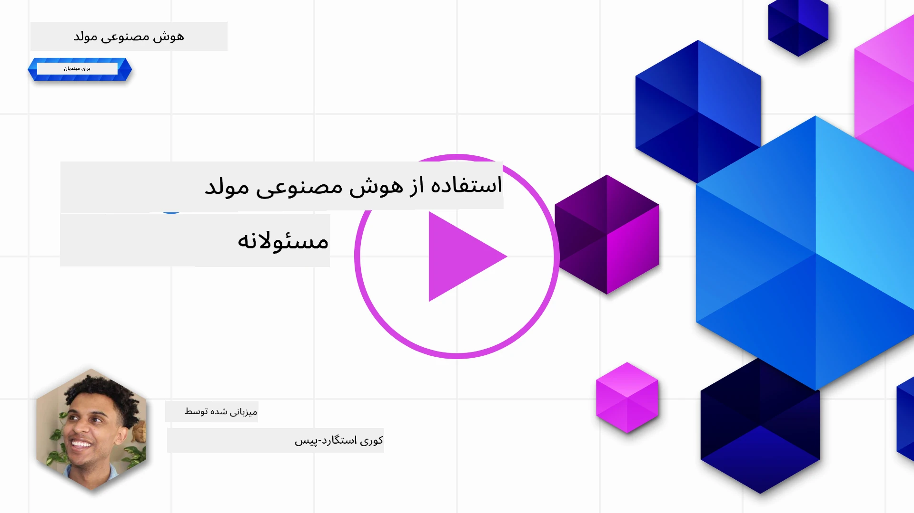
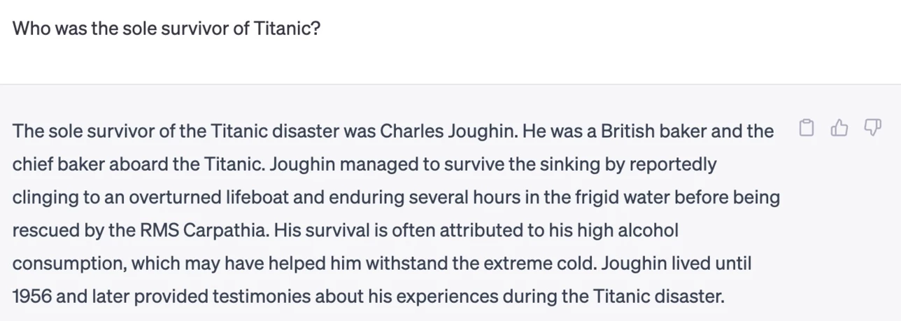
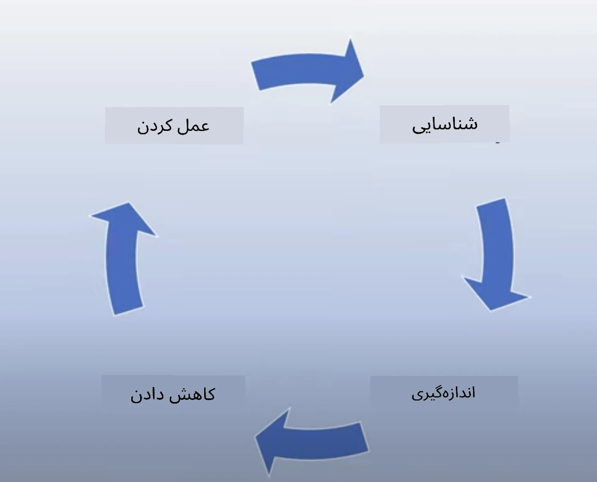
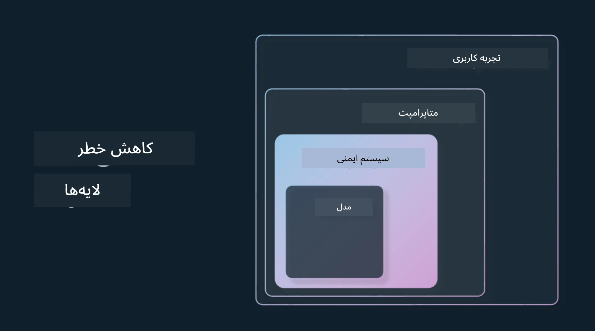

# استفاده مسئولانه از هوش مصنوعی مولد

> _برای مشاهده ویدئوی این درس روی تصویر بالا کلیک کنید_

هوش مصنوعی، به‌ویژه هوش مصنوعی مولد، می‌تواند بسیار جذاب باشد، اما باید در نظر داشته باشید که چگونه می‌توانید از آن به‌صورت مسئولانه استفاده کنید. باید به مواردی مانند اطمینان از خروجی منصفانه، غیرمضر و موارد دیگر توجه کنید. این فصل قصد دارد زمینه‌های ذکر شده، مواردی که باید در نظر گرفته شوند و نحوه برداشتن گام‌های فعال برای بهبود استفاده از هوش مصنوعی را به شما ارائه دهد.

## مقدمه

این درس شامل موارد زیر خواهد بود:

- چرا باید هنگام ساخت برنامه‌های هوش مصنوعی مولد، اولویت را به هوش مصنوعی مسئولانه بدهید.
- اصول اصلی هوش مصنوعی مسئولانه و ارتباط آن‌ها با هوش مصنوعی مولد.
- نحوه به‌کارگیری این اصول هوش مصنوعی مسئولانه از طریق استراتژی و ابزارها.

## اهداف یادگیری

پس از اتمام این درس، شما خواهید دانست:

- اهمیت هوش مصنوعی مسئولانه هنگام ساخت برنامه‌های هوش مصنوعی مولد.
- زمان فکر کردن و اعمال اصول اصلی هوش مصنوعی مسئولانه هنگام ساخت برنامه‌های هوش مصنوعی مولد.
- چه ابزارها و استراتژی‌هایی برای به‌کارگیری مفهوم هوش مصنوعی مسئولانه در دسترس شما هستند.

## اصول هوش مصنوعی مسئولانه

هیجان پیرامون هوش مصنوعی مولد هیچ‌گاه به این اندازه بالا نبوده است. این هیجان باعث جذب تعداد زیادی توسعه‌دهنده جدید، توجه و سرمایه‌گذاری به این حوزه شده است. در حالی که این موضوع برای هر کسی که به دنبال ساخت محصولات و شرکت‌ها با استفاده از هوش مصنوعی مولد است بسیار مثبت است، اما مهم است که با مسئولیت پیش برویم.

در طول این دوره، ما بر ساخت استارتاپ و محصول آموزشی هوش مصنوعی خود تمرکز می‌کنیم. از اصول هوش مصنوعی مسئولانه استفاده خواهیم کرد: انصاف، شمول، قابلیت اطمینان/ایمنی، امنیت و حریم خصوصی، شفافیت و پاسخگویی. با این اصول، بررسی خواهیم کرد که چگونه این اصول با استفاده ما از هوش مصنوعی مولد در محصولاتمان مرتبط هستند.

## چرا باید به هوش مصنوعی مسئولانه اولویت دهید

هنگام ساخت یک محصول، اتخاذ رویکردی انسان‌محور با در نظر گرفتن بهترین منافع کاربران، به بهترین نتایج منجر می‌شود.

ویژگی منحصر به فرد هوش مصنوعی مولد قدرت آن در ایجاد پاسخ‌های مفید، اطلاعات، راهنمایی و محتوا برای کاربران است. این کار می‌تواند بدون مراحل دستی زیاد انجام شود که منجر به نتایج بسیار چشمگیر می‌شود. بدون برنامه‌ریزی و استراتژی‌های مناسب، متأسفانه ممکن است به نتایج مضر برای کاربران، محصول شما و جامعه به‌طور کلی منجر شود.

بیایید به برخی از این نتایج بالقوه مضر نگاه کنیم:

### توهمات

توهمات اصطلاحی است که برای توصیف زمانی استفاده می‌شود که یک مدل زبانی بزرگ (LLM) محتوایی تولید می‌کند که یا کاملاً بی‌معنی است یا چیزی که می‌دانیم بر اساس منابع دیگر اطلاعاتی نادرست است.

به‌عنوان مثال، فرض کنید ما یک ویژگی برای استارتاپ خود ایجاد می‌کنیم که به دانش‌آموزان اجازه می‌دهد سوالات تاریخی از یک مدل بپرسند. یک دانش‌آموز سوالی مانند `چه کسی تنها بازمانده کشتی تایتانیک بود؟` می‌پرسد.

مدل پاسخی مانند زیر تولید می‌کند:

> _(منبع: [Flying bisons](https://flyingbisons.com?WT.mc_id=academic-105485-koreyst))_

این پاسخ بسیار مطمئن و کامل است. متأسفانه، این پاسخ نادرست است. حتی با حداقل تحقیق، می‌توان دریافت که بیش از یک بازمانده از فاجعه تایتانیک وجود داشته است. برای دانش‌آموزی که تازه شروع به تحقیق در این موضوع کرده است، این پاسخ می‌تواند به اندازه کافی قانع‌کننده باشد که مورد سوال قرار نگیرد و به‌عنوان حقیقت پذیرفته شود. پیامدهای این موضوع می‌تواند منجر به غیرقابل اعتماد بودن سیستم هوش مصنوعی و تأثیر منفی بر شهرت استارتاپ ما شود.

با هر نسخه جدید از یک مدل زبانی بزرگ، شاهد بهبود عملکرد در کاهش توهمات بوده‌ایم. حتی با این بهبود، ما به‌عنوان سازندگان و کاربران برنامه‌ها همچنان باید از این محدودیت‌ها آگاه باشیم.

### محتوای مضر

در بخش قبلی پوشش دادیم که زمانی که یک مدل زبانی بزرگ پاسخ‌های نادرست یا بی‌معنی تولید می‌کند. خطر دیگری که باید از آن آگاه باشیم زمانی است که یک مدل با محتوای مضر پاسخ می‌دهد.

محتوای مضر می‌تواند به‌صورت زیر تعریف شود:

- ارائه دستورالعمل‌ها یا تشویق به خودآزاری یا آسیب به گروه‌های خاص.
- محتوای نفرت‌انگیز یا تحقیرآمیز.
- راهنمایی برای برنامه‌ریزی هر نوع حمله یا اعمال خشونت‌آمیز.
- ارائه دستورالعمل‌هایی برای یافتن محتوای غیرقانونی یا ارتکاب اعمال غیرقانونی.
- نمایش محتوای جنسی صریح.

برای استارتاپ ما، می‌خواهیم مطمئن شویم که ابزارها و استراتژی‌های مناسبی برای جلوگیری از دیده شدن این نوع محتوا توسط دانش‌آموزان داریم.

### عدم انصاف

انصاف به‌عنوان "اطمینان از اینکه یک سیستم هوش مصنوعی عاری از تعصب و تبعیض است و همه را به‌طور منصفانه و برابر رفتار می‌کند" تعریف می‌شود. در دنیای هوش مصنوعی مولد، می‌خواهیم مطمئن شویم که دیدگاه‌های انحصاری گروه‌های به حاشیه رانده شده توسط خروجی مدل تقویت نمی‌شود.

این نوع خروجی‌ها نه تنها برای ایجاد تجربه‌های مثبت محصول برای کاربران ما مخرب هستند، بلکه باعث آسیب بیشتر به جامعه نیز می‌شوند. به‌عنوان سازندگان برنامه‌ها، باید همیشه یک پایگاه کاربری گسترده و متنوع را در نظر داشته باشیم هنگام ساخت راه‌حل‌ها با هوش مصنوعی مولد.

## چگونه از هوش مصنوعی مولد به‌صورت مسئولانه استفاده کنیم

اکنون که اهمیت هوش مصنوعی مولد مسئولانه را شناسایی کرده‌ایم، بیایید به ۴ مرحله‌ای که می‌توانیم برای ساخت راه‌حل‌های هوش مصنوعی خود به‌صورت مسئولانه برداریم، نگاه کنیم:

### اندازه‌گیری آسیب‌های بالقوه

در تست نرم‌افزار، ما اقدامات مورد انتظار یک کاربر در یک برنامه را آزمایش می‌کنیم. به‌طور مشابه، آزمایش مجموعه‌ای متنوع از درخواست‌هایی که کاربران احتمالاً استفاده خواهند کرد، راه خوبی برای اندازه‌گیری آسیب‌های بالقوه است.

از آنجا که استارتاپ ما در حال ساخت یک محصول آموزشی است، خوب است که لیستی از درخواست‌های مرتبط با آموزش آماده کنیم. این می‌تواند شامل پوشش یک موضوع خاص، حقایق تاریخی و درخواست‌هایی درباره زندگی دانش‌آموزی باشد.

### کاهش آسیب‌های بالقوه

اکنون زمان آن رسیده است که راه‌هایی پیدا کنیم که بتوانیم از آسیب‌های بالقوه ناشی از مدل و پاسخ‌های آن جلوگیری کنیم یا آن‌ها را محدود کنیم. می‌توانیم این موضوع را در ۴ لایه مختلف بررسی کنیم:

- **مدل**. انتخاب مدل مناسب برای مورد استفاده مناسب. مدل‌های بزرگ‌تر و پیچیده‌تر مانند GPT-4 می‌توانند خطر محتوای مضر بیشتری ایجاد کنند وقتی برای موارد استفاده کوچک‌تر و خاص‌تر اعمال شوند. استفاده از داده‌های آموزشی خود برای تنظیم دقیق نیز خطر محتوای مضر را کاهش می‌دهد.

- **سیستم ایمنی**. سیستم ایمنی مجموعه‌ای از ابزارها و تنظیمات در پلتفرم ارائه‌دهنده مدل است که به کاهش آسیب کمک می‌کند. نمونه‌ای از این سیستم، سیستم فیلتر محتوای سرویس Azure OpenAI است. سیستم‌ها باید حملات نفوذ و فعالیت‌های ناخواسته مانند درخواست‌های ربات‌ها را نیز شناسایی کنند.

- **متاپرومت**. متاپرومت‌ها و پایه‌گذاری روش‌هایی هستند که می‌توانیم مدل را بر اساس رفتارها و اطلاعات خاص هدایت یا محدود کنیم. این می‌تواند استفاده از ورودی‌های سیستمی برای تعریف محدودیت‌های خاص مدل باشد. علاوه بر این، ارائه خروجی‌هایی که بیشتر مرتبط با دامنه یا حوزه سیستم هستند.

همچنین می‌توان از تکنیک‌هایی مانند تولید مبتنی بر بازیابی (RAG) استفاده کرد تا مدل فقط اطلاعات را از مجموعه‌ای از منابع معتبر استخراج کند. درسی در ادامه این دوره برای [ساخت برنامه‌های جستجو](../08-building-search-applications/README.md?WT.mc_id=academic-105485-koreyst) وجود دارد.

- **تجربه کاربری**. لایه نهایی جایی است که کاربر به‌طور مستقیم از طریق رابط برنامه ما به مدل تعامل می‌کند. به این ترتیب می‌توانیم طراحی UI/UX را برای محدود کردن کاربر در انواع ورودی‌هایی که می‌تواند به مدل ارسال کند و همچنین متن یا تصاویر نمایش داده شده به کاربر طراحی کنیم. هنگام استقرار برنامه هوش مصنوعی، باید شفاف باشیم که برنامه هوش مصنوعی مولد ما چه کاری می‌تواند انجام دهد و چه کاری نمی‌تواند انجام دهد.

ما یک درس کامل اختصاص داده‌ایم به [طراحی UX برای برنامه‌های هوش مصنوعی](../12-designing-ux-for-ai-applications/README.md?WT.mc_id=academic-105485-koreyst)

- **ارزیابی مدل**. کار با مدل‌های زبانی بزرگ می‌تواند چالش‌برانگیز باشد زیرا همیشه کنترل کاملی بر داده‌هایی که مدل بر اساس آن‌ها آموزش دیده است نداریم. با این حال، باید همیشه عملکرد و خروجی‌های مدل را ارزیابی کنیم. همچنان مهم است که دقت، شباهت، پایه‌گذاری و ارتباط خروجی مدل را اندازه‌گیری کنیم. این به ارائه شفافیت و اعتماد به ذینفعان و کاربران کمک می‌کند.

### راه‌اندازی یک راه‌حل مسئولانه هوش مصنوعی مولد

ساخت یک رویه عملیاتی پیرامون برنامه‌های هوش مصنوعی شما مرحله نهایی است. این شامل همکاری با بخش‌های دیگر استارتاپ ما مانند بخش حقوقی و امنیتی برای اطمینان از رعایت تمام سیاست‌های قانونی است. قبل از راه‌اندازی، همچنین می‌خواهیم برنامه‌هایی پیرامون تحویل، مدیریت حوادث و بازگشت به عقب ایجاد کنیم تا از هرگونه آسیب به کاربران خود جلوگیری کنیم.

## ابزارها

در حالی که کار توسعه راه‌حل‌های هوش مصنوعی مسئولانه ممکن است زیاد به نظر برسد، این کار ارزش تلاش را دارد. با رشد حوزه هوش مصنوعی مولد، ابزارهای بیشتری برای کمک به توسعه‌دهندگان در ادغام مسئولیت به‌طور کارآمد در جریان کارشان توسعه خواهد یافت. به‌عنوان مثال، [Azure AI Content Safety](https://learn.microsoft.com/azure/ai-services/content-safety/overview?WT.mc_id=academic-105485-koreyst) می‌تواند از طریق درخواست API به شناسایی محتوای مضر و تصاویر کمک کند.

## بررسی دانش

چه مواردی را باید در نظر بگیرید تا از استفاده مسئولانه از هوش مصنوعی اطمینان حاصل کنید؟

1. اینکه پاسخ صحیح باشد.
1. استفاده مضر، اینکه هوش مصنوعی برای اهداف جنایی استفاده نشود.
1. اطمینان از اینکه هوش مصنوعی عاری از تعصب و تبعیض است.

پاسخ: گزینه‌های ۲ و ۳ صحیح هستند. هوش مصنوعی مسئولانه به شما کمک می‌کند تا نحوه کاهش اثرات مضر و تعصبات و موارد دیگر را در نظر بگیرید.

## 🚀 چالش

در مورد [Azure AI Content Safety](https://learn.microsoft.com/azure/ai-services/content-safety/overview?WT.mc_id=academic-105485-koreyst) مطالعه کنید و ببینید چه چیزی را می‌توانید برای استفاده خود به کار ببرید.

## کار عالی، ادامه یادگیری خود را ادامه دهید

پس از اتمام این درس، مجموعه [آموزش هوش مصنوعی مولد](https://aka.ms/genai-collection?WT.mc_id=academic-105485-koreyst) ما را بررسی کنید تا دانش خود در زمینه هوش مصنوعی مولد را ارتقا دهید!

به درس چهارم بروید، جایی که اصول [مهندسی پرامپت](../04-prompt-engineering-fundamentals/README.md?WT.mc_id=academic-105485-koreyst) را بررسی خواهیم کرد!

---

**سلب مسئولیت**:  
این سند با استفاده از سرویس ترجمه هوش مصنوعی [Co-op Translator](https://github.com/Azure/co-op-translator) ترجمه شده است. در حالی که ما تلاش می‌کنیم دقت را حفظ کنیم، لطفاً توجه داشته باشید که ترجمه‌های خودکار ممکن است شامل خطاها یا نادرستی‌ها باشند. سند اصلی به زبان اصلی آن باید به عنوان منبع معتبر در نظر گرفته شود. برای اطلاعات حیاتی، ترجمه حرفه‌ای انسانی توصیه می‌شود. ما مسئولیتی در قبال سوء تفاهم‌ها یا تفسیرهای نادرست ناشی از استفاده از این ترجمه نداریم.