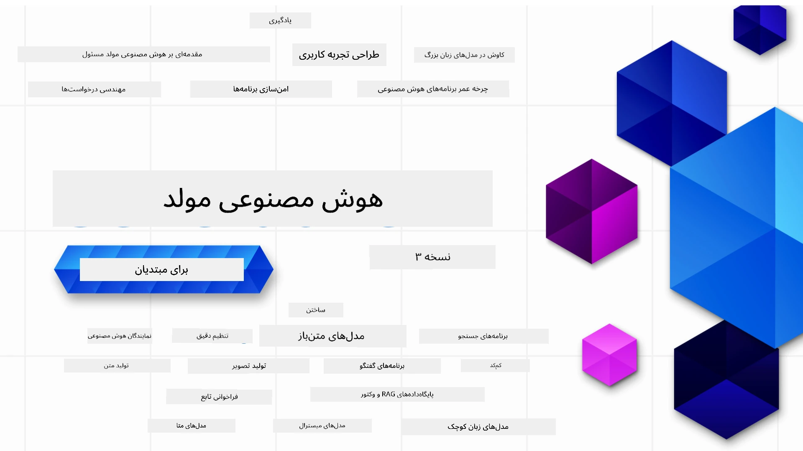

### ۲۱ درس جامع و کاربردی برای شروع ساخت برنامه‌های هوش مصنوعی مولد

[](https://github.com/microsoft/Generative-AI-For-Beginners/blob/master/LICENSE?WT.mc_id=academic-105485-koreyst)
[](https://GitHub.com/microsoft/Generative-AI-For-Beginners/graphs/contributors/?WT.mc_id=academic-105485-koreyst)
[](https://GitHub.com/microsoft/Generative-AI-For-Beginners/issues/?WT.mc_id=academic-105485-koreyst)
[](https://GitHub.com/microsoft/Generative-AI-For-Beginners/pulls/?WT.mc_id=academic-105485-koreyst)
[](http://makeapullrequest.com?WT.mc_id=academic-105485-koreyst)

[](https://GitHub.com/microsoft/Generative-AI-For-Beginners/watchers/?WT.mc_id=academic-105485-koreyst)
[](https://GitHub.com/microsoft/Generative-AI-For-Beginners/network/?WT.mc_id=academic-105485-koreyst)
[](https://GitHub.com/microsoft/Generative-AI-For-Beginners/stargazers/?WT.mc_id=academic-105485-koreyst)

[](https://discord.gg/nTYy5BXMWG)

### 🌐 پشتیبانی چندزبانه

#### پشتیبانی از طریق GitHub Action (ترجمه مداوم و به‌روز)

<!-- CO-OP TRANSLATOR LANGUAGES TABLE START -->
[عربی](../ar/README.md) | [بنگالی](../bn/README.md) | [بلغاری](../bg/README.md) | [برمه‌ای (میانمار)](../my/README.md) | [چینی (ساده شده)](../zh-CN/README.md) | [چینی (سنتی، هنگ‌کنگ)](../zh-HK/README.md) | [چینی (سنتی، ماکائو)](../zh-MO/README.md) | [چینی (سنتی، تایوان)](../zh-TW/README.md) | [کرواتی](../hr/README.md) | [چکی](../cs/README.md) | [دانمارکی](../da/README.md) | [هلندی](../nl/README.md) | [استونیایی](../et/README.md) | [فنلاندی](../fi/README.md) | [فرانسوی](../fr/README.md) | [آلمانی](../de/README.md) | [یونانی](../el/README.md) | [عبری](../he/README.md) | [هندی](../hi/README.md) | [مجاری](../hu/README.md) | [اندونزیایی](../id/README.md) | [ایتالیایی](../it/README.md) | [ژاپنی](../ja/README.md) | [کانادا](../kn/README.md) | [خمر](../km/README.md) | [کره‌ای](../ko/README.md) | [لیتوانیایی](../lt/README.md) | [مالایی](../ms/README.md) | [مالایالام](../ml/README.md) | [مراتی](../mr/README.md) | [نپالی](../ne/README.md) | [پیدجین نیجریه‌ای](../pcm/README.md) | [نروژی](../no/README.md) | [فارسی (Farsi)](./README.md) | [لهستانی](../pl/README.md) | [پرتغالی (برزیل)](../pt-BR/README.md) | [پرتغالی (پرتغال)](../pt-PT/README.md) | [پنجابی (گرموخی)](../pa/README.md) | [رومانیایی](../ro/README.md) | [روسی](../ru/README.md) | [صربی (سیریلیک)](../sr/README.md) | [اسلواکی](../sk/README.md) | [اسلونیایی](../sl/README.md) | [اسپانیایی](../es/README.md) | [سواحلی](../sw/README.md) | [سوئدی](../sv/README.md) | [تاگالوگ (فیلیپینی)](../tl/README.md) | [تامیل](../ta/README.md) | [تلگو](../te/README.md) | [تایلندی](../th/README.md) | [ترکی](../tr/README.md) | [اوکراینی](../uk/README.md) | [اردو](../ur/README.md) | [ویتنامی](../vi/README.md)

> **ترجیح می‌دهید به صورت محلی و سبک کلون کنید؟**
>
> این مخزن شامل بیش از ۵۰ ترجمه زبانی است که حجم دانلود را افزایش می‌دهد. برای کلون کردن بدون فایل‌های ترجمه سایر زبان‌ها، می‌توانید از sparse-checkout گیت استفاده کنید:
>
> **Bash / macOS / Linux:**
> ```bash
> git clone --filter=blob:none --sparse https://github.com/microsoft/generative-ai-for-beginners.git
> cd generative-ai-for-beginners
> git sparse-checkout set --no-cone '/*' '!translations' '!translated_images'
> ```
>
> **CMD (ویندوز):**
> ```cmd
> git clone --filter=blob:none --sparse https://github.com/microsoft/generative-ai-for-beginners.git
> cd generative-ai-for-beginners
> git sparse-checkout set --no-cone "/*" "!translations" "!translated_images"
> ```
>
> این دستورات تنها کدهای اصلی دوره را با سرعتی بسیار بالا دانلود خواهند کرد.
<!-- CO-OP TRANSLATOR LANGUAGES TABLE END -->

# هوش مصنوعی مولد برای مبتدیان (نسخه ۳) — یک دوره آموزشی جامع

اصول و مهارت‌های ساخت برنامه‌های مدرن هوش مصنوعی مولد را با دوره ۲۱ جلسه‌ای و پروژه‌محور مهندسان ابری مایکروسافت (Microsoft Cloud Advocates) بیاموزید.

## 🌱 شروع یادگیری

این دوره شامل ۲۱ درسنامه تخصصی به همراه یک جلسه راه‌اندازی است. هر جلسه موضوع مستقل و منسجمی را پوشش می‌دهد، بنابراین می‌توانید یادگیری را از هر نقطه‌ای که نیاز دارید آغاز کنید!

دروس این دوره به دو شاخه کلی تقسیم شده‌اند:
- **شاخه «یادگیری» (Learn):** مفاهیم نظری، سازوکار مدل‌ها و اصول بنیادین هوش مصنوعی مولد را تشریح می‌کند.
- **شاخه «ساخت» (Build):** پیاده‌سازی عملی و نمونه‌کدهای واقعی را در دو زبان **Python** و **TypeScript** ارائه می‌دهد.

> برای توسعه‌دهندگان اکوسیستم دات‌نت، دوره تخصصی [هوش مصنوعی مولد برای مبتدیان (نسخه .NET)](https://github.com/microsoft/Generative-AI-for-beginners-dotnet?WT.mc_id=academic-105485-koreyst) نیز در دسترس است!

در پایان هر جلسه نیز بخشی تحت عنوان «ادامه یادگیری» قرار دارد که مراجع تکمیلی و ابزارهای مرتبط را برای تعمیق دانش در اختیارتان می‌گذارد.

## 🛠️ نیازمندی‌ها و پیش‌نیازها

### برای اجرای کدهای این دوره، می‌توانید از یکی از بسترهای زیر استفاده نمایید:
- [سرویس Azure OpenAI](https://aka.ms/genai-beginners/azure-open-ai?WT.mc_id=academic-105485-koreyst) — پروژه‌های پوشه `aoai-assignment`
- [کاتالوگ مدل‌های Microsoft Foundry](https://ai.azure.com/catalog/models?WT.mc_id=academic-105485-koreyst) — پروژه‌های پوشه `githubmodels` (مدل‌های GitHub در حال انتقال به Microsoft Foundry هستند)
- [رابط برنامه‌نویسی OpenAI API](https://aka.ms/genai-beginners/open-ai?WT.mc_id=academic-105485-koreyst) — پروژه‌های پوشه `oai-assignment`
- [محیط Foundry Local](https://foundrylocal.ai?WT.mc_id=academic-105485-koreyst) — اجرای کاملاً آفلاین و محلی مدل‌ها روی سیستم شخصی بدون نیاز به اشتراک ابری

### دانش و ابزارهای مورد نیاز:
- آشنایی پایه با زبان Python یا TypeScript مفید است — اگر در ابتدای راه برنامه‌نویسی هستید، دوره‌های رایگان مایکروسافت برای [آموزش Python](https://aka.ms/genai-beginners/python?WT.mc_id=academic-105485-koreyst) و [آموزش TypeScript](https://aka.ms/genai-beginners/typescript?WT.mc_id=academic-105485-koreyst) را بررسی فرمایید.
- یک حساب کاربری در گیت‌هاب برای [فورک کردن این مخزن](https://aka.ms/genai-beginners/github?WT.mc_id=academic-105485-koreyst) به حساب شخصی‌تان.
- پیشنهاد می‌کنیم ابتدا درسنامه **[راه‌اندازی دوره](./00-course-setup/README.md?WT.mc_id=academic-105485-koreyst)** را مطالعه فرمایید تا محیط توسعه شما (VS Code یا Codespaces) آماده شود.
- فراموش نکنید این مخزن را [ستاره (🌟) دهید](https://docs.github.com/en/get-started/exploring-projects-on-github/saving-repositories-with-stars?WT.mc_id=academic-105485-koreyst) تا همواره در دسترس شما باشد.

## 🧠 آماده استقرار و توسعه پیشرفته؟

اگر به دنبال نمونه‌کدهای پیشرفته‌تر و ساختارهای آماده سازمانی هستید، مخزن نمونه‌کدهای رسمی هوش مصنوعی مولد مایکروسافت را در هر دو زبان **Python** و **TypeScript** مشاهده فرمایید: [مشاهده نمونه‌کدها ↗](https://aka.ms/genai-beg-code?WT.mc_id=academic-105485-koreyst)

## 🗣️ جامعه یادگیرندگان و دریافت پشتیبانی

- به [سرور رسمی دیسکورد Microsoft Foundry](https://aka.ms/genai-discord?WT.mc_id=academic-105485-koreyst) بپیوندید تا با سایر توسعه‌دهندگان در سراسر جهان در ارتباط باشید و سوالات فنی خود را مطرح کنید.
- سوالات، نظرات و بازخوردهای خود درباره محصولات هوش مصنوعی را در [تالار گفتگوی توسعه‌دهندگان Microsoft Foundry](https://aka.ms/azureaifoundry/forum) در گیت‌هاب به اشتراک بگذارید.

## 🚀 در حال ساخت استارتاپ هستید؟

برای شروع ساخت محصولات هوش مصنوعی با استفاده از اعتبارهای رایگان ابری Azure، برنامه [مایکروسافت برای استارتاپ‌ها (Microsoft for Startups)](https://www.microsoft.com/startups?WT.mc_id=academic-105485-koreyst) را بررسی فرمایید.

## 🙏 مشارکت در بهبود دوره

اگر پیشنهاد، بازخورد یا پیشنهادی برای تصحیح ترجمه و کدها دارید:
- [یک ایشیو ثبت کنید (Open an Issue)](https://github.com/microsoft/generative-ai-for-beginners/issues?WT.mc_id=academic-105485-koreyst)
- [یک درخواست ادغام بفرستید (Create a Pull Request)](https://github.com/microsoft/generative-ai-for-beginners/pulls?WT.mc_id=academic-105485-koreyst)

## 📂 ساختار هر درسنامه:

- یک ویدیوی آموزشی کوتاه جهت معرفی سرفصل.
- درسنامه جامع متنی با ساختار مدون و توضیحات گام‌به‌گام.
- نمونه‌کدهای تست‌شده پایتون و تایپ‌اسکریپت با پشتیبانی از Azure OpenAI و OpenAI API.
- پیوند به منابع معتبر برای ادامه یادگیری و تمرین عملی.

---

## 🗃️ سرفصل‌ها و درسنامه‌های دوره

تمام پیوندهای زیر مستقیماً نسخه فارسی هر درسنامه را باز می‌کنند:

| شماره | عنوان و لینک درسنامه فارسی | توضیحات و دستاورد آموزشی | ویدیو | یادگیری بیشتر |
| :---: | :--- | :--- | :---: | :---: |
| **00** | [راه‌اندازی محیط و شروع کار با دوره](./00-course-setup/README.md?WT.mc_id=academic-105485-koreyst) | **یادگیری:** آماده‌سازی محیط‌های ابری GitHub Codespaces و سیستم محلی | به زودی | [مطالعه بیشتر](https://aka.ms/genai-collection?WT.mc_id=academic-105485-koreyst) |
| **01** | [مقدمه‌ای بر هوش مصنوعی مولد و مدل‌های زبانی بزرگ (LLMs)](./01-introduction-to-genai/README.md?WT.mc_id=academic-105485-koreyst) | **یادگیری:** آشنایی با ترنسفورمرها و درک عمیق سازوکار یادگیری مدل‌های زبانی | [ویدیو](https://aka.ms/gen-ai-lesson-1-gh?WT.mc_id=academic-105485-koreyst) | [مطالعه بیشتر](https://aka.ms/genai-collection?WT.mc_id=academic-105485-koreyst) |
| **02** | [کاوش و مقایسه مدل‌های زبانی گوناگون](./02-exploring-and-comparing-different-llms/README.md?WT.mc_id=academic-105485-koreyst) | **یادگیری:** ارزیابی و انتخاب بهینه‌ترین مدل متناسب با هزینه، سرعت و کاربرد | [ویدیو](https://aka.ms/gen-ai-lesson2-gh?WT.mc_id=academic-105485-koreyst) | [مطالعه بیشتر](https://aka.ms/genai-collection?WT.mc_id=academic-105485-koreyst) |
| **03** | [استفاده مسئولانه و اخلاقی از هوش مصنوعی مولد](./03-using-generative-ai-responsibly/README.md?WT.mc_id=academic-105485-koreyst) | **یادگیری:** چارچوب شش‌گانه ایمنی، کاهش خطرات سوگیری و توهم در مدل‌ها | [ویدیو](https://aka.ms/gen-ai-lesson3-gh?WT.mc_id=academic-105485-koreyst) | [مطالعه بیشتر](https://aka.ms/genai-collection?WT.mc_id=academic-105485-koreyst) |
| **04** | [مبانی و اصول اساسی مهندسی پرامپت](./04-prompt-engineering-fundamentals/README.md?WT.mc_id=academic-105485-koreyst) | **یادگیری:** بهترین الگوهای طراحی پرامپت، تنظیم نقش‌ها و کنترل خروجی | [ویدیو](https://aka.ms/gen-ai-lesson4-gh?WT.mc_id=academic-105485-koreyst) | [مطالعه بیشتر](https://aka.ms/genai-collection?WT.mc_id=academic-105485-koreyst) |
| **05** | [تکنیک‌های پیشرفته در طراحی پرامپت](./05-advanced-prompts/README.md?WT.mc_id=academic-105485-koreyst) | **یادگیری:** متدهای زنجیره تفکر (CoT)، پرامپت‌های استدلالی و خودسازگاری | [ویدیو](https://aka.ms/gen-ai-lesson5-gh?WT.mc_id=academic-105485-koreyst) | [مطالعه بیشتر](https://aka.ms/genai-collection?WT.mc_id=academic-105485-koreyst) |
| **06** | [ساخت برنامه‌های کاربردی تولید متن](./06-text-generation-apps/README.md?WT.mc_id=academic-105485-koreyst) | **ساخت:** پیاده‌سازی برنامه تولید متن با Azure OpenAI و OpenAI API | [ویدیو](https://aka.ms/gen-ai-lesson6-gh?WT.mc_id=academic-105485-koreyst) | [مطالعه بیشتر](https://aka.ms/genai-collection?WT.mc_id=academic-105485-koreyst) |
| **07** | [ساخت برنامه‌های گفتگومحور (چت‌بات‌های هوشمند)](./07-building-chat-applications/README.md?WT.mc_id=academic-105485-koreyst) | **ساخت:** مدیریت تاریخچه گفتگو، حافظه کانتکست و جلوگیری از سرریز توکن | [ویدیو](https://aka.ms/gen-ai-lessons7-gh?WT.mc_id=academic-105485-koreyst) | [مطالعه بیشتر](https://aka.ms/genai-collection?WT.mc_id=academic-105485-koreyst) |
| **08** | [ساخت سامانه‌های جستجوی معنایی و وکتور](./08-building-search-applications/README.md?WT.mc_id=academic-105485-koreyst) | **ساخت:** تولید بردارها (Embeddings) و ساخت برنامه جستجوی معنایی هوشمند | [ویدیو](https://aka.ms/gen-ai-lesson8-gh?WT.mc_id=academic-105485-koreyst) | [مطالعه بیشتر](https://aka.ms/genai-collection?WT.mc_id=academic-105485-koreyst) |
| **09** | [ساخت برنامه‌های تولید و پردازش تصویر](./09-building-image-applications/README.md?WT.mc_id=academic-105485-koreyst) | **ساخت:** ارتباط با مدل‌های DALL-E و تولید تصویر از متن با کدنویسی | [ویدیو](https://aka.ms/gen-ai-lesson9-gh?WT.mc_id=academic-105485-koreyst) | [مطالعه بیشتر](https://aka.ms/genai-collection?WT.mc_id=academic-105485-koreyst) |
| **10** | [ساخت برنامه‌های کم‌کد (Low-Code) با هوش مصنوعی](./10-building-low-code-ai-applications/README.md?WT.mc_id=academic-105485-koreyst) | **ساخت:** یکپارچه‌سازی مدل‌های هوش مصنوعی با Power Platform و جریان‌های کاری | [ویدیو](https://aka.ms/gen-ai-lesson10-gh?WT.mc_id=academic-105485-koreyst) | [مطالعه بیشتر](https://aka.ms/genai-collection?WT.mc_id=academic-105485-koreyst) |
| **11** | [یکپارچه‌سازی ابزارها با فراخوانی تابع (Function Calling)](./11-integrating-with-function-calling/README.md?WT.mc_id=academic-105485-koreyst) | **ساخت:** اتصال مدل زبانی به توابع بومی سیستم و APIهای خارجی | [ویدیو](https://aka.ms/gen-ai-lesson11-gh?WT.mc_id=academic-105485-koreyst) | [مطالعه بیشتر](https://aka.ms/genai-collection?WT.mc_id=academic-105485-koreyst) |
| **12** | [طراحی تجربه کاربری (UX) برای برنامه‌های هوش مصنوعی](./12-designing-ux-for-ai-applications/README.md?WT.mc_id=academic-105485-koreyst) | **یادگیری:** اصول طراحی رابط‌های تعاملی، بازخورددهی و شفافیت در UX هوش مصنوعی | [ویدیو](https://aka.ms/gen-ai-lesson12-gh?WT.mc_id=academic-105485-koreyst) | [مطالعه بیشتر](https://aka.ms/genai-collection?WT.mc_id=academic-105485-koreyst) |
| **13** | [امنیت و حفاظت از سامانه‌های هوش مصنوعی](./13-securing-ai-applications/README.md?WT.mc_id=academic-105485-koreyst) | **یادگیری:** مقابله با حملات تزریق پرامپت (Prompt Injection) و حفاظت از داده‌ها | [ویدیو](https://aka.ms/gen-ai-lesson13-gh?WT.mc_id=academic-105485-koreyst) | [مطالعه بیشتر](https://aka.ms/genai-collection?WT.mc_id=academic-105485-koreyst) |
| **14** | [چرخه حیات توسعه و مدیریت عملیات (LLMOps)](./14-the-generative-ai-application-lifecycle/README.md?WT.mc_id=academic-105485-koreyst) | **یادگیری:** استقرار، مانیتورینگ مداوم، ارزیابی کمی و مدیریت چرخه عمر برنامه‌ها | [ویدیو](https://aka.ms/gen-ai-lesson14-gh?WT.mc_id=academic-105485-koreyst) | [مطالعه بیشتر](https://aka.ms/genai-collection?WT.mc_id=academic-105485-koreyst) |
| **15** | [بازیابی اطلاعات با متد RAG و پایگاه‌های برداری](./15-rag-and-vector-databases/README.md?WT.mc_id=academic-105485-koreyst) | **ساخت:** معماری سیستم‌های پرسش‌وپاسخ بر روی مستندات اختصاصی با RAG | [ویدیو](https://aka.ms/gen-ai-lesson15-gh?WT.mc_id=academic-105485-koreyst) | [مطالعه بیشتر](https://aka.ms/genai-collection?WT.mc_id=academic-105485-koreyst) |
| **16** | [کار با مدل‌های متن‌باز و اکوسیستم Hugging Face](./16-open-source-models/README.md?WT.mc_id=academic-105485-koreyst) | **ساخت:** اجرای مدل‌های زبانی متن‌باز، استفاده از پایپ‌لاین‌ها و اجرای محلی | [ویدیو](https://aka.ms/gen-ai-lesson16-gh?WT.mc_id=academic-105485-koreyst) | [مطالعه بیشتر](https://aka.ms/genai-collection?WT.mc_id=academic-105485-koreyst) |
| **17** | [عامل‌های هوشمند خودمختار (AI Agents)](./17-ai-agents/README.md?WT.mc_id=academic-105485-koreyst) | **ساخت:** طراحی سیستم‌های خودمختار تصمیم‌گیر و فریم‌ورک‌های چندعاملی | [ویدیو](https://aka.ms/gen-ai-lesson17-gh?WT.mc_id=academic-105485-koreyst) | [مطالعه بیشتر](https://aka.ms/genai-collection?WT.mc_id=academic-105485-koreyst) |
| **18** | [فاین‌تیونینگ و فاین‌تیونینگ (Fine-Tuning) مدل‌های زبانی](./18-fine-tuning/README.md?WT.mc_id=academic-105485-koreyst) | **یادگیری:** مفاهیم، مزایا، شرایط استفاده و تکنیک‌های سبک فاین‌تیونینگ (LoRA/PEFT) | [ویدیو](https://aka.ms/gen-ai-lesson18-gh?WT.mc_id=academic-105485-koreyst) | [مطالعه بیشتر](https://aka.ms/genai-collection?WT.mc_id=academic-105485-koreyst) |
| **19** | [مدل‌های زبانی کوچک (سری Phi مایکروسافت)](./19-slm/README.md?WT.mc_id=academic-105485-koreyst) | **یادگیری:** مزایای معماری‌های سبک، سرعت بالا و اجرای آفلاین روی دستگاه‌ها | به زودی | [مطالعه بیشتر](https://aka.ms/genai-collection?WT.mc_id=academic-105485-koreyst) |
| **20** | [توسعه با مدل‌های پرقدرت میسترال (Mistral)](./20-mistral/README.md?WT.mc_id=academic-105485-koreyst) | **یادگیری:** معماری نوین ترکیبی از متخصصان (MoE) و قابلیت‌های خانواده Mistral | به زودی | [مطالعه بیشتر](https://aka.ms/genai-collection?WT.mc_id=academic-105485-koreyst) |
| **21** | [توسعه با مدل‌های لاما ۳ متا (Meta Llama)](./21-meta/README.md?WT.mc_id=academic-105485-koreyst) | **یادگیری:** اکوسیستم باز مدل‌های Llama 3، استقرار در محیط‌های ابری و محلی | به زودی | [مطالعه بیشتر](https://aka.ms/genai-collection?WT.mc_id=academic-105485-koreyst) |

### 🌟 تشکر ویژه

تشکر ویژه از [**جان عزیز (John Isaac)**](https://www.linkedin.com/in/john0isaac/) برای ساخت تمام GitHub Actions و گردش‌های کاری خودکار ترجمه.

تشکر از [**برنهاد مرکل (Bernhard Merkle)**](https://www.linkedin.com/in/bernhard-merkle-738b73/) برای ارائه راهنمایی‌ها و اصلاحات کلیدی در سورس‌کد درسنامه‌ها.

## 🎒 سایر دوره‌های آموزشی مایکروسافت

<!-- CO-OP TRANSLATOR OTHER COURSES START -->
### دوره لانگ‌چین
[](https://aka.ms/langchain4j-for-beginners)
[](https://aka.ms/langchainjs-for-beginners?WT.mc_id=m365-94501-dwahlin)
[](https://github.com/microsoft/langchain-for-beginners?WT.mc_id=m365-94501-dwahlin)

---

### آزور / اج / MCP / عامل‌ها
[](https://github.com/microsoft/AZD-for-beginners?WT.mc_id=academic-105485-koreyst)
[](https://github.com/microsoft/edgeai-for-beginners?WT.mc_id=academic-105485-koreyst)
[](https://github.com/microsoft/mcp-for-beginners?WT.mc_id=academic-105485-koreyst)
[](https://github.com/microsoft/ai-agents-for-beginners?WT.mc_id=academic-105485-koreyst)

---

### سری هوش مصنوعی مولد
[](https://github.com/microsoft/generative-ai-for-beginners?WT.mc_id=academic-105485-koreyst)
[-9333EA?style=for-the-badge&labelColor=E5E7EB&color=9333EA)](https://github.com/microsoft/Generative-AI-for-beginners-dotnet?WT.mc_id=academic-105485-koreyst)
[-C084FC?style=for-the-badge&labelColor=E5E7EB&color=C084FC)](https://github.com/microsoft/generative-ai-for-beginners-java?WT.mc_id=academic-105485-koreyst)
[-E879F9?style=for-the-badge&labelColor=E5E7EB&color=E879F9)](https://github.com/microsoft/generative-ai-with-javascript?WT.mc_id=academic-105485-koreyst)

---

### علوم داده و پایه‌های یادگیری
[](https://aka.ms/ml-beginners?WT.mc_id=academic-105485-koreyst)
[](https://aka.ms/datascience-beginners?WT.mc_id=academic-105485-koreyst)
[](https://aka.ms/ai-beginners?WT.mc_id=academic-105485-koreyst)
[](https://github.com/microsoft/Security-101?WT.mc_id=academic-96948-sayoung)
[](https://aka.ms/webdev-beginners?WT.mc_id=academic-105485-koreyst)
[](https://aka.ms/iot-beginners?WT.mc_id=academic-105485-koreyst)
[](https://github.com/microsoft/xr-development-for-beginners?WT.mc_id=academic-105485-koreyst)

---

### سری کوپایلوت
[](https://aka.ms/GitHubCopilotAI?WT.mc_id=academic-105485-koreyst)
[](https://github.com/microsoft/mastering-github-copilot-for-dotnet-csharp-developers?WT.mc_id=academic-105485-koreyst)
[](https://github.com/microsoft/CopilotAdventures?WT.mc_id=academic-105485-koreyst)
<!-- CO-OP TRANSLATOR OTHER COURSES END -->

## ارتباط و پشتیبانی

اگر هنگام اجرای کدهای دوره با پرسش یا چالشی مواجه شدید، به جامعه توسعه‌دهندگان مایکروسافت بپیوندید:

[](https://discord.gg/nTYy5BXMWG)

برای ارسال بازخورد مستقیم یا گزارش مشکلات محصولات هوش مصنوعی:

[](https://aka.ms/foundry/forum)

---

<!-- CO-OP TRANSLATOR DISCLAIMER START -->
**سلب مسئولیت و شفافیت ترجمه**:
این سند در ابتدا از طریق سرویس ترجمه خودکار [Co-op Translator](https://github.com/Azure/co-op-translator) پردازش شده و سپس توسط مشارکت‌کنندگان جامعه فارسی‌زبان از نظر روانی، اصطلاحات فنی و صحت نگارش به زبان فارسی ویرایش و بازنویسی شده است. مرجع اصلی و رسمی دوره، اسناد زبان انگلیسی در همین مخزن است.
<!-- CO-OP TRANSLATOR DISCLAIMER END -->
