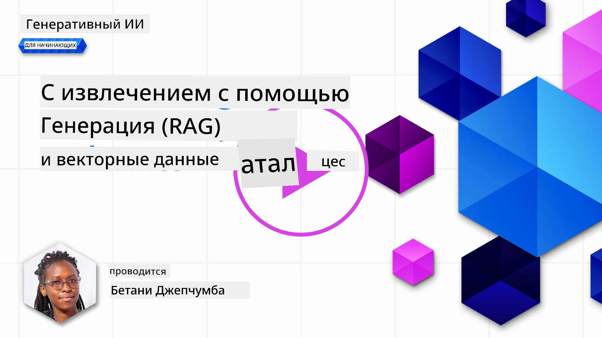
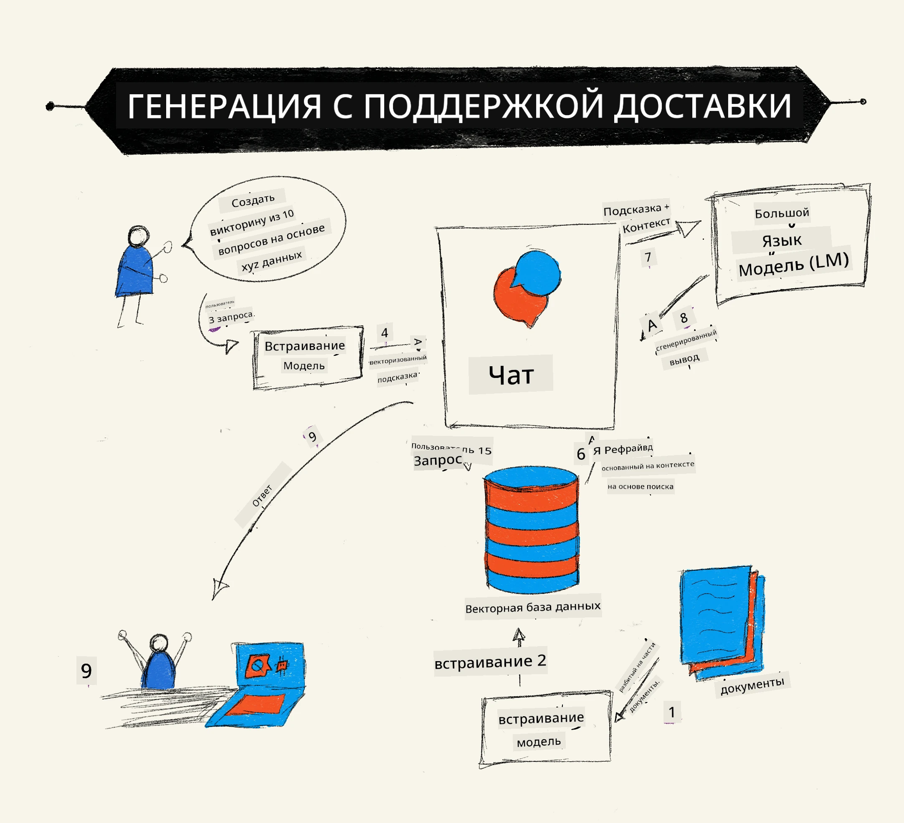
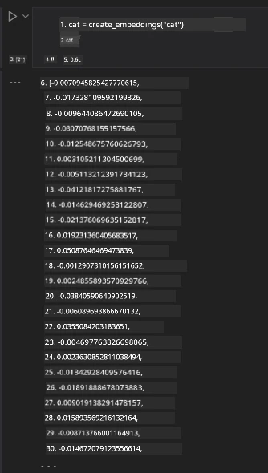

# Генерация с поддержкой поиска (RAG) и векторные базы данных

[](https://youtu.be/4l8zhHUBeyI?si=BmvDmL1fnHtgQYkL)

В уроке по поисковым приложениям мы кратко изучили, как интегрировать свои данные в большие языковые модели (LLM). В этом уроке мы углубимся в концепции закрепления ваших данных в приложении LLM, механику процесса и методы хранения данных, включая как эмбеддинги, так и текст.

> **Видео скоро появится**

## Введение

В этом уроке мы рассмотрим следующее:

- Введение в RAG: что это такое и почему оно используется в ИИ (искусственном интеллекте).

- Понимание векторных баз данных и создание одной для нашего приложения.

- Практический пример интеграции RAG в приложение.

## Цели обучения

После прохождения этого урока вы сможете:

- Объясните значение RAG в извлечении и обработке данных.

- Настройте приложение RAG и свяжите LLM с вашими данными

- Эффективно интегрируйте RAG и векторные базы данных в приложения LLM.

## Наш сценарий: улучшение наших LLM с помощью собственных данных

Для этого урока мы хотим добавить собственные заметки в образовательный стартап, что позволит чат-боту получать больше информации по разным предметам. Используя наши заметки, учащиеся смогут учиться лучше и понимать разные темы, что облегчит подготовку к экзаменам. Для создания нашего сценария мы будем использовать:

- `Azure OpenAI:` LLM, которую мы используем для создания чат-бота

- `Урок "ИИ для начинающих" по нейронным сетям`: это будут данные, на которых мы закрепим наш LLM

- `Azure AI Search` и `Azure Cosmos DB:` векторная база данных для хранения наших данных и создания поискового индекса

Пользователи смогут создавать тренировочные викторины и карточки для повторения из своих заметок, а также кратко обобщать эти заметки. Чтобы начать, давайте посмотрим, что такое RAG и как он работает:

## Генерация с поддержкой поиска (RAG)

Чат-бот с поддержкой LLM обрабатывает пользовательские запросы для генерации ответов. Он разработан для интерактивного взаимодействия и общения с пользователями по широкому кругу тем. Однако его ответы ограничены предоставленным контекстом и базовыми тренировочными данными. Например, знание GPT-4 ограничено сентябрем 2021 года, то есть он не знает событий после этого периода. Кроме того, данные для тренировки LLM исключают конфиденциальную информацию, такую как личные заметки или руководство по продукту компании.

### Как работает RAG (генерация с поддержкой поиска)



Предположим, вы хотите развернуть чат-бота, который создает тесты по вашим заметкам, для этого потребуется подключение к базе знаний. Здесь на помощь приходит RAG. RAG работает следующим образом:

- **База знаний:** Перед поиском документы необходимо загрузить и предварительно обработать, обычно разбивая большие документы на небольшие фрагменты, преобразовывая их в текстовые эмбеддинги и сохраняя в базе данных.

- **Пользовательский запрос:** пользователь задает вопрос

- **Поиск:** Когда пользователь задает вопрос, модель для создания эмбеддингов извлекает релевантную информацию из нашей базы знаний, чтобы добавить контекст в запрос.

- **Улучшенная генерация:** LLM улучшает свой ответ на основе полученных данных. Это позволяет сгенерированному ответу основываться не только на предварительно обученных данных, но и на релевантной информации из добавленного контекста. Извлеченные данные используются для улучшения ответов LLM. Затем LLM возвращает ответ на вопрос пользователя.


RAG объединяет извлекатель с генератором: запрос преобразуется в вектор, сравнивается с индексом документов для поиска соответствующих фрагментов текста, и эти фрагменты предоставляются в качестве контекста для LLM, которая генерирует ответ. Извлекатель и генератор могут использовать разные модели; RAG не требует трансформера с энкодером-декодером.

Существует два подхода к реализации RAG согласно предложенной статье: [Retrieval-Augmented Generation for Knowledge intensive NLP (natural language processing software) Tasks](https://arxiv.org/pdf/2005.11401.pdf?WT.mc_id=academic-105485-koreyst):

- **_RAG-Sequence_** — использование извлеченных документов для предсказания наилучшего ответа на запрос пользователя

- **RAG-Token** — использование документов для генерации следующего токена, затем извлечение для ответа на запрос пользователя

### Зачем использовать RAG?

- **Богатство информации:** обеспечивает актуальность и современность текстовых ответов. Это повышает производительность в задачах, специфичных для домена, за счет доступа к внутренней базе знаний.

- Снижает искажения, используя **проверяемые данные** из базы знаний для предоставления контекста пользовательским запросам.

- Это **экономично**, поскольку требует меньших затрат по сравнению с дообучением LLM.

## Создание базы знаний

Наше приложение основано на наших личных данных, то есть на уроке по нейронным сетям из учебного курса Искусственный интеллект для начинающих.

### Векторные базы данных

Векторная база данных, в отличие от традиционных баз, это специализированная база для хранения, управления и поиска встроенных векторов. Она хранит числовые представления документов. Преобразование данных в числовые эмбеддинги облегчает понимание и обработку информации нашей AI-системой.

Поскольку у LLM есть ограничение на количество входных токенов, мы разбиваем документы на части перед их встраиванием. Когда пользователь задаёт вопрос, встраивания, наиболее похожие на запрос, определяют соответствующие текстовые фрагменты, которые возвращаются вместе с подсказкой. Разбиение на части также снижает количество токенов, передаваемых LLM, и, следовательно, может уменьшить затраты.

Некоторые популярные векторные базы данных включают Azure Cosmos DB, Clarifyai, Pinecone, Chromadb, ScaNN, Qdrant и DeepLake. Вы можете создать модель Azure Cosmos DB с помощью Azure CLI с помощью следующей команды:

```bash
az login
az group create -n <resource-group-name> -l <location>
az cosmosdb create -n <cosmos-db-name> -r <resource-group-name>
az cosmosdb list-keys -n <cosmos-db-name> -g <resource-group-name>
```

### От текста к эмбеддингам

Перед тем как хранить данные, их необходимо преобразовать в векторные эмбеддинги. Если вы работаете с большими документами или длинными текстами, их можно разбивать на части в зависимости от ожидаемых запросов. Разбиение может происходить на уровне предложений или абзацев. Поскольку смысл определяется словами вокруг, к части можно добавить некоторый контекст, например, название документа или текст перед или после части. Разбиение данных можно выполнить следующим образом:

```python
def split_text(text, max_length, min_length):
    words = text.split()
    chunks = []
    current_chunk = []

    for word in words:
        current_chunk.append(word)
        if len(' '.join(current_chunk)) < max_length and len(' '.join(current_chunk)) > min_length:
            chunks.append(' '.join(current_chunk))
            current_chunk = []

    # Если последний блок не достиг минимальной длины, добавьте его в любом случае
    if current_chunk:
        chunks.append(' '.join(current_chunk))

    return chunks
```

После разбиения мы можем создать эмбеддинги текста с помощью различных моделей эмбеддингов. Некоторые из них: word2vec, ada-002 от OpenAI, Azure Computer Vision и многие другие. Выбор модели зависит от используемых языков, типа кодируемого контента (текст/изображения/аудио), размера входных данных и длины выходного эмбеддинга.

Пример текста, встроенного моделью `text-embedding-ada-002` от OpenAI:


## Поиск и векторный поиск

Когда пользователь задает вопрос, ретривер преобразует его в вектор с помощью кодировщика запроса, а затем ищет в нашем поисковом индексе документы с релевантными векторами, связанными с входным запросом. После этого преобразует как входной вектор, так и векторы документов в текст и передает их LLM.

### Поиск

Поиск происходит, когда система пытается быстро найти документы из индекса, удовлетворяющие критериям поиска. Цель ретривера — получить документы, которые будут использоваться для предоставления контекста и закрепления LLM на ваших данных.

Существует несколько способов выполнения поиска в нашей базе данных, например:

- **Поиск по ключевым словам** — используется для текстовых поисков

- **Векторный поиск** — преобразует документы из текста в векторные представления с помощью моделей эмбеддинга, что позволяет выполнять **семантический поиск** по смыслу слов. Поиск осуществляется путем запроса документов с векторами, наиболее близкими к вопросу пользователя.

- **Гибридный** — сочетание поиска по ключевым словам и векторного поиска.

Проблема поиска возникает, когда в базе нет похожего ответа на запрос, тогда система возвращает максимально релевантную информацию. Вы можете настроить максимальное расстояние для релевантности или использовать гибридный поиск, который комбинирует ключевые слова и векторный поиск. В этом уроке мы используем гибридный поиск и будем хранить данные в dataframe с колонками для частей текста и эмбеддингов.

### Векторное сходство

Ретривер будет искать в базе знаний векторы вложений (эмбеддингов), расположенные близко друг к другу — ближайших соседей — поскольку они представляют похожие тексты. В этом сценарии, когда пользователь отправляет запрос, он сначала преобразуется в вектор, а затем сопоставляется с похожими векторами. Наиболее распространённой мерой для сравнения сходства векторов является косинусное сходство, основанное на угле между двумя векторами.

Другие метрики, которые мы можем использовать для измерения сходства, включают евклидово расстояние — прямую линию между конечными точками векторов, и скалярное произведение, которое измеряет сумму произведений соответствующих элементов двух векторов.

### Поисковый индекс

При выполнении поиска необходимо построить поисковый индекс для базы знаний перед поиском. Индекс хранит наши эмбеддинги и быстро находит наиболее похожие части даже в большой базе данных. Индекс можно создать локально с помощью:

```python
from sklearn.neighbors import NearestNeighbors

embeddings = flattened_df['embeddings'].to_list()

# Создать поисковый индекс
nbrs = NearestNeighbors(n_neighbors=5, algorithm='ball_tree').fit(embeddings)

# Для запроса к индексу можно использовать метод kneighbors
distances, indices = nbrs.kneighbors(embeddings)
```

### Переоценка (Re-ranking)

После запроса к базе, возможно, потребуется отсортировать результаты по убыванию релевантности. Модель переоценки LLM использует машинное обучение для повышения релевантности результатов поиска, упорядочивая их от самых релевантных. В Azure AI Search переоценка выполняется автоматически с помощью семантического переоценщика. Пример работы переоценки с использованием ближайших соседей:

```python
# Find the most similar documents
distances, indices = nbrs.kneighbors([query_vector])

# Print the three most similar documents with their distance to the question
for distance, index in zip(distances[0][:3], indices[0][:3]):
    print(flattened_df['chunks'].iloc[index])
    print(flattened_df['path'].iloc[index])
    print(distance)
```

## Объединяем всё вместе

Последний шаг — добавить наш LLM, чтобы получать ответы, основанные на наших данных. Реализовать это можно следующим образом:

```python
user_input = "what is a perceptron?"

def chatbot(user_input):
    # Преобразовать вопрос в вектор запроса
    query_vector = create_embeddings(user_input)

    # Найти наиболее похожие документы
    distances, indices = nbrs.kneighbors([query_vector])

    # добавить документы к запросу для предоставления контекста
    history = []
    for index in indices[0]:
        history.append(flattened_df['chunks'].iloc[index])

    # объединить историю и ввод пользователя
    history.append(user_input)

    # создать объект сообщения
    messages=[
        {"role": "system", "content": "You are an AI assistant that helps with AI questions."},
        {"role": "user", "content": "\n\n".join(history) }
    ]

    # использовать API Ответов для генерации ответа
    response = client.responses.create(
        model="gpt-5-mini",
        max_output_tokens=800,
        input=messages,
        store=False,
    )

    return response.output_text

chatbot(user_input)
```

## Оценка нашего приложения

### Метрики оценки

- Качество предоставляемых ответов, чтобы они звучали естественно, плавно и как от человека

- Закрепленность данных: оценка, пришел ли ответ из предоставленных документов

- Релевантность: проверка соответствия и связи ответа с заданным вопросом

- Грамотность — соответствует ли ответ грамматике и смыслу

## Сценарии использования RAG (Генерация с поддержкой поиска) и векторных баз данных

Существует множество различных сценариев использования, где RAG может улучшить ваше приложение, например:

- Вопросы и ответы: закрепление данных вашей компании для чата, которым могут пользоваться сотрудники для получения ответов.

- Рекомендательные системы: создание системы, которая подбирает наиболее похожие значения, например фильмы, рестораны и многое другое.

- Чат-боты: хранение истории чата и персонализация разговора на основе данных пользователя.

- Поиск изображений на основе векторных эмбеддингов, полезно при распознавании изображений и обнаружении аномалий.

## Итог

Мы рассмотрели основные области RAG: от добавления наших данных в приложение до запроса пользователя и вывода результата. Чтобы упростить создание RAG, вы можете использовать такие фреймворки, как Semantic Kernel, LangChain или AutoGen.

## Домашнее задание

Для продолжения изучения Retrieval Augmented Generation (RAG) вы можете создать:

- Фронтенд для приложения, используя выбранный вами фреймворк

- Использовать фреймворк LangChain или Semantic Kernel и воссоздать ваше приложение.

Поздравляем с завершением урока 👏.

## Обучение не заканчивается здесь, продолжайте путешествие

После прохождения этого урока ознакомьтесь с нашей [коллекцией по обучению генеративному ИИ](https://aka.ms/genai-collection?WT.mc_id=academic-105485-koreyst), чтобы продолжить улучшать знания в области генеративного ИИ!

---

<!-- CO-OP TRANSLATOR DISCLAIMER START -->
**Отказ от ответственности**:
Этот документ был переведен с использованием сервиса машинного перевода [Co-op Translator](https://github.com/Azure/co-op-translator). Несмотря на наши усилия по обеспечению точности, имейте в виду, что автоматический перевод может содержать ошибки или неточности. Оригинальный документ на его исходном языке следует считать авторитетным источником. Для получения критически важной информации рекомендуется обратиться к профессиональному человеческому переводу. Мы не несем ответственности за любые недоразумения или неправильные толкования, возникшие в результате использования этого перевода.
<!-- CO-OP TRANSLATOR DISCLAIMER END -->