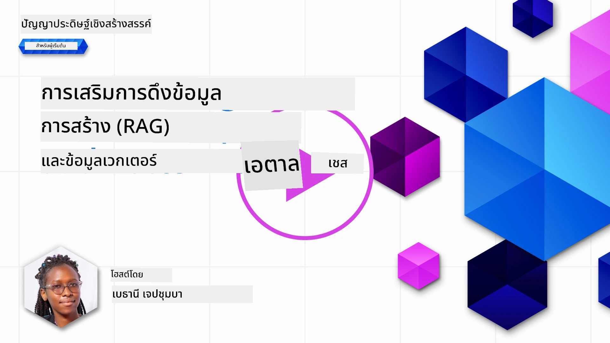
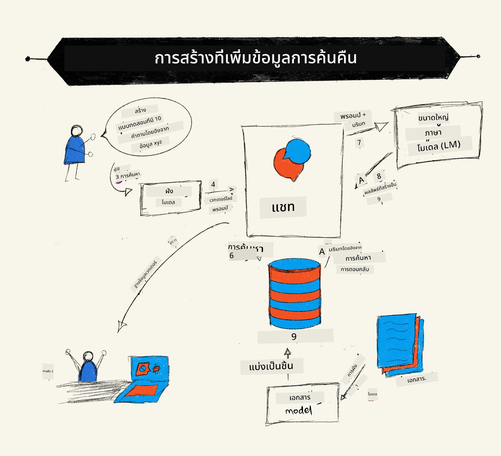
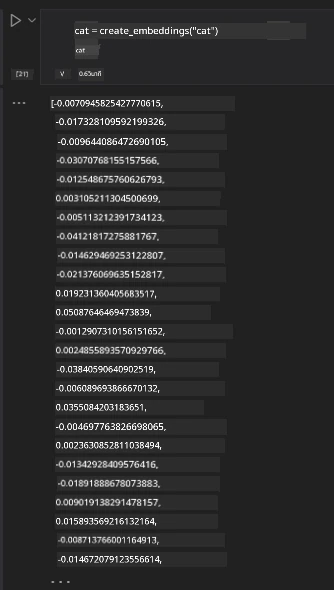

# การสร้างข้อความที่เสริมด้วยการดึงข้อมูล (RAG) และฐานข้อมูลเวกเตอร์

[](https://youtu.be/4l8zhHUBeyI?si=BmvDmL1fnHtgQYkL)

ในบทเรียนแอปพลิเคชันการค้นหา เราได้เรียนรู้สั้น ๆ ว่าจะผสานข้อมูลของคุณเองเข้ากับโมเดลภาษาใหญ่ (LLMs) อย่างไร บทเรียนนี้เราจะเจาะลึกมากขึ้นเกี่ยวกับแนวคิดการเสริมฐานข้อมูลของคุณในแอป LLM ของคุณ กลไกของกระบวนการและวิธีการจัดเก็บข้อมูล รวมถึงทั้ง embeddings และข้อความ

> **วิดีโอจะมาเร็ว ๆ นี้**

## บทนำ

ในบทเรียนนี้เราจะครอบคลุมหัวข้อต่อไปนี้:

- การแนะนำ RAG คืออะไรและทำไมจึงนำไปใช้ใน AI (ปัญญาประดิษฐ์)

- ความเข้าใจว่าฐานข้อมูลเวกเตอร์คืออะไรและการสร้างฐานข้อมูลหนึ่งสำหรับแอปพลิเคชันของเรา

- ตัวอย่างแบบปฏิบัติในการผสาน RAG เข้ากับแอปพลิเคชัน

## เป้าหมายการเรียนรู้

หลังจากจบบทเรียนนี้ คุณจะสามารถ:

- อธิบายความสำคัญของ RAG ในการดึงข้อมูลและประมวลผลข้อมูล

- ตั้งค่าแอปพลิเคชัน RAG และเชื่อมต่อ LLM กับข้อมูลของคุณ

- รวม RAG และฐานข้อมูลเวกเตอร์เข้าด้วยกันอย่างมีประสิทธิภาพในแอปพลิเคชัน LLM

## กรณีของเรา: การเพิ่มประสิทธิภาพ LLM ของเราด้วยข้อมูลของเราเอง

สำหรับบทเรียนนี้ เราต้องการเพิ่มบันทึกของเราเองเข้าไปในสตาร์ทอัปการศึกษา ซึ่งช่วยให้แชทบอทได้รับข้อมูลเพิ่มเติมในหัวข้อต่าง ๆ การใช้บันทึกที่เรามี ผู้เรียนจะสามารถศึกษาได้ดีขึ้นและเข้าใจหัวข้อต่าง ๆ ง่ายขึ้น ทำให้การทบทวนสำหรับการสอบเป็นไปได้สะดวกขึ้น ในการสร้างกรณีของเรา เราจะใช้:

- `Azure OpenAI:` LLM ที่เราจะใช้สร้างแชทบอทของเรา

- `บทเรียน AI สำหรับผู้เริ่มต้นเกี่ยวกับ Neural Networks`: ข้อมูลที่เราจะใช้เสริมฐานกับ LLM ของเรา

- `Azure AI Search` และ `Azure Cosmos DB:` ฐานข้อมูลเวกเตอร์สำหรับจัดเก็บข้อมูลและสร้างดัชนีการค้นหา

ผู้ใช้จะสามารถสร้างแบบทดสอบฝึกหัดและแฟลชการ์ดทบทวนจากบันทึกของตนและสรุปบันทึกเหล่านั้นให้อยู่ในรูปแบบภาพรวมที่กระชับได้ ในการเริ่มต้น มาเรียนรู้ว่า RAG คืออะไรและทำงานอย่างไร:

## การสร้างข้อความที่เสริมด้วยการดึงข้อมูล (Retrieval Augmented Generation, RAG)

แชทบอทที่ขับเคลื่อนด้วย LLM จะประมวลผลคำถามจากผู้ใช้เพื่อสร้างคำตอบ ออกแบบมาให้โต้ตอบได้และมีส่วนร่วมกับผู้ใช้ในหัวข้อต่าง ๆ อย่างกว้างขวาง อย่างไรก็ตามคำตอบที่ได้จะจำกัดอยู่ที่บริบทที่จัดเตรียมและข้อมูลพื้นฐานที่ได้รับการฝึกฝน ตัวอย่างเช่น GPT-4 มีความรู้จำกัดถึงกันยายน 2021 หมายความว่าขาดความรู้เกี่ยวกับเหตุการณ์ที่เกิดขึ้นหลังจากนั้น นอกจากนี้ข้อมูลที่ใช้ฝึก LLM จะไม่รวมข้อมูลลับเช่นบันทึกส่วนตัวหรือคู่มือผลิตภัณฑ์ของบริษัท

### RAG (Retrieval Augmented Generation) ทำงานอย่างไร



สมมติว่าคุณต้องการเปิดตัวแชทบอทที่สร้างแบบทดสอบจากบันทึกของคุณ คุณจะต้องเชื่อมต่อกับฐานความรู้ นี่คือที่ที่ RAG ช่วยได้ RAG ทำงานดังนี้:

- **ฐานความรู้:** ก่อนการดึงข้อมูล เอกสารเหล่านี้จะต้องถูกนำเข้าและประมวลผลล่วงหน้า ปกติจะมีการแบ่งเอกสารขนาดใหญ่ออกเป็นชิ้นเล็ก ๆ แปลงเป็น embedding ข้อความและจัดเก็บในฐานข้อมูล

- **คำถามผู้ใช้:** ผู้ใช้ถามคำถาม

- **การดึงข้อมูล:** เมื่อผู้ใช้ถามคำถาม โมเดล embedding จะดึงข้อมูลที่เกี่ยวข้องจากฐานความรู้ของเราเพื่อจัดเตรียมบริบทเพิ่มเติมที่จะรวมเข้ากับ prompt

- **การสร้างข้อความเสริม:** LLM จะปรับปรุงคำตอบโดยอิงจากข้อมูลที่ดึงมา ซึ่งช่วยให้คำตอบที่สร้างไม่ใช่แค่ขึ้นอยู่กับข้อมูลที่ได้รับการฝึกฝน แต่ยังรวมข้อมูลบริบทที่เกี่ยวข้องจากข้อมูลที่เพิ่มเข้ามา ข้อมูลที่ดึงมาใช้เสริมคำตอบของ LLM จากนั้น LLM จะส่งคำตอบกลับคำถามของผู้ใช้


RAG ผสานตัวดึงข้อมูลกับตัวสร้าง: คำค้นจะถูกแปลงเป็นเวกเตอร์, ทำการจับคู่กับดัชนีเอกสารเพื่อค้นหาเนื้อหาที่เกี่ยวข้อง, และเนื้อหาเหล่านั้นจะถูกนำไปใช้เป็นบริบทกับ LLM ซึ่งจะสร้างคำตอบขึ้นมา ตัวดึงข้อมูลและตัวสร้างอาจใช้โมเดลที่ต่างกัน; RAG ไม่จำเป็นต้องใช้ทรานส์ฟอร์เมอร์แบบเข้ารหัส-ถอดรหัส

สองแนวทางในการนำ RAG ไปใช้ตามเอกสารที่เสนอ: [Retrieval-Augmented Generation for Knowledge intensive NLP (natural language processing software) Tasks](https://arxiv.org/pdf/2005.11401.pdf?WT.mc_id=academic-105485-koreyst) ได้แก่:

- **_RAG-Sequence_** ใช้เอกสารที่ดึงมาเพื่อทำนายคำตอบที่ดีที่สุดสำหรับคำถามของผู้ใช้

- **RAG-Token** ใช้เอกสารเพื่อสร้างโทเค็นถัดไป จากนั้นดึงเอกสารเหล่านั้นมาเพื่อตอบคำถามของผู้ใช้

### ทำไมคุณจึงควรใช้ RAG?

- **ข้อมูลที่มีความหลากหลาย:** ทำให้คำตอบเป็นปัจจุบันและล่าสุด ดังนั้นจะช่วยเพิ่มประสิทธิภาพงานเฉพาะด้านโดยเข้าถึงฐานความรู้ภายใน

- ลดการแต่งเรื่องโดยใช้ **ข้อมูลที่ตรวจสอบได้** ในฐานความรู้เพื่อจัดเตรียมบริบทสำหรับคำถามของผู้ใช้

- **ประหยัดค่าใช้จ่าย** เพราะมีค่าใช้จ่ายถูกกว่าการปรับแต่ง LLM อย่างละเอียด

## การสร้างฐานความรู้

แอปพลิเคชันของเราขึ้นอยู่กับข้อมูลส่วนบุคคลของเรา เช่น บทเรียนเครือข่ายประสาทเทียมจากหลักสูตร AI สำหรับผู้เริ่มต้น

### ฐานข้อมูลเวกเตอร์

ฐานข้อมูลเวกเตอร์ ต่างจากฐานข้อมูลแบบเดิม ๆ เป็นฐานข้อมูลเฉพาะเพื่อจัดเก็บ จัดการ และค้นหาเวกเตอร์ฝังตัว มันจัดเก็บการแทนค่าตัวเลขของเอกสาร การแตกข้อมูลเป็น embedding ตัวเลขช่วยให้ระบบ AI ของเราเข้าใจและประมวลผลข้อมูลได้ง่ายขึ้น

เนื่องจาก LLM มีขีดจำกัดของจำนวนโทเค็นนำเข้า เราจึงแบ่งเอกสารออกเป็นชิ้นส่วนก่อนที่จะฝัง เมื่อผู้ใช้ถามคำถาม การฝังที่ใกล้เคียงกับคำถามมากที่สุดจะระบุชิ้นส่วนข้อความที่เกี่ยวข้อง ซึ่งจะถูกส่งคืนพร้อมกับพรอมต์ การแบ่งชิ้นส่วนยังช่วยลดจำนวนโทเค็นที่ส่งไปยัง LLM และจึงช่วยลดค่าใช้จ่ายได้

บางฐานข้อมูลเวกเตอร์ยอดนิยมเช่น Azure Cosmos DB, Clarifyai, Pinecone, Chromadb, ScaNN, Qdrant และ DeepLake คุณสามารถสร้างโมเดล Azure Cosmos DB โดยใช้ Azure CLI ด้วยคำสั่งต่อไปนี้:

```bash
az login
az group create -n <resource-group-name> -l <location>
az cosmosdb create -n <cosmos-db-name> -r <resource-group-name>
az cosmosdb list-keys -n <cosmos-db-name> -g <resource-group-name>
```

### จากข้อความเป็น embeddings

ก่อนจัดเก็บข้อมูล เราจะต้องแปลงข้อมูลเป็น vector embeddings ก่อนจัดเก็บในฐานข้อมูล หากคุณทำงานกับเอกสารขนาดใหญ่หรือข้อความยาว คุณสามารถแบ่งชิ้นตามคำถามที่คาดหวังได้ การแบ่งชิ้นสามารถทำได้ที่ระดับประโยค หรือย่อหน้า เนื่องจากการแบ่งชิ้นอิงความหมายจากคำรอบ ๆ คุณสามารถเพิ่มบริบทอื่น ๆ ให้ชิ้น เช่น เพิ่มชื่อเอกสารหรือข้อความก่อนหรือหลังชิ้นได้ คุณสามารถแบ่งข้อมูลได้ดังนี้:

```python
def split_text(text, max_length, min_length):
    words = text.split()
    chunks = []
    current_chunk = []

    for word in words:
        current_chunk.append(word)
        if len(' '.join(current_chunk)) < max_length and len(' '.join(current_chunk)) > min_length:
            chunks.append(' '.join(current_chunk))
            current_chunk = []

    # หากชิ้นสุดท้ายไม่ถึงความยาวขั้นต่ำ ก็ให้เพิ่มเข้าไปอย่างนั้นแหละ
    if current_chunk:
        chunks.append(' '.join(current_chunk))

    return chunks
```

เมื่อแบ่งชิ้นแล้ว เราสามารถฝังข้อความโดยใช้โมเดล embedding ต่าง ๆ ได้ โมเดลที่ใช้ได้เช่น word2vec, ada-002 โดย OpenAI, Azure Computer Vision และอื่น ๆ การเลือกโมเดลใช้ขึ้นกับภาษาที่คุณใช้ ประเภทเนื้อหาที่เข้ารหัส (ข้อความ/ภาพ/เสียง) ขนาดอินพุตที่รองรับ และความยาวผลลัพธ์ embedding

ตัวอย่างข้อความที่ฝังโดยใช้โมเดล `text-embedding-ada-002` ของ OpenAI คือ:


## การดึงข้อมูลและการค้นหาเวกเตอร์

เมื่อผู้ใช้ถามคำถาม ตัวดึงข้อมูลจะเปลี่ยนคำถามเป็นเวกเตอร์โดยใช้ query encoder จากนั้นค้นหาเวกเตอร์ที่เกี่ยวข้องในดัชนีเอกสาร เมื่อเสร็จแล้วจะแปลงอินพุตเวกเตอร์และเวกเตอร์เอกสารเป็นข้อความแล้วส่งผ่าน LLM

### การดึงข้อมูล

การดึงข้อมูลเกิดขึ้นเมื่อระบบพยายามค้นหาเอกสารจากดัชนีที่ตรงตามเกณฑ์การค้นหา เป้าหมายของตัวดึงข้อมูลคือการได้เอกสารที่ใช้ให้บริบทและเสริมฐาน LLM ของคุณ

มีหลายวิธีค้นหาในฐานข้อมูล เช่น:

- **การค้นหาด้วยคำสำคัญ** - ใช้สำหรับการค้นหาข้อความ

- **การค้นหาเวกเตอร์** - แปลงเอกสารจากข้อความเป็นเวกเตอร์โดยใช้โมเดล embedding อนุญาตให้ค้นหาเชิงความหมาย **semantic search** โดยใช้ความหมายของคำ การดึงข้อมูลจะใช้ออนไลน์เอกสารที่เวกเตอร์ใกล้เคียงกับคำถามผู้ใช้มากที่สุด

- **ผสมผสาน** - การรวมกันของการค้นหาด้วยคำสำคัญและเวกเตอร์

ความท้าทายของการดึงข้อมูลคือเมื่อไม่มีคำตอบใกล้เคียงในฐานข้อมูล ระบบจะคืนข้อมูลที่ดีที่สุดที่หาได้ อย่างไรก็ตามคุณสามารถใช้วิธีตั้งค่าระยะทางสูงสุดสำหรับความเกี่ยวข้อง หรือใช้การค้นหาผสมที่รวมทั้งคำสำคัญและเวกเตอร์ ในบทเรียนนี้เราจะใช้การค้นหาผสม โดยจัดเก็บข้อมูลใน dataframe ที่มีคอลัมน์บรรจุชิ้นและ embedding

### ความคล้ายคลึงของเวกเตอร์

ตัวดึงข้อมูลจะค้นหาผ่านฐานความรู้สำหรับการฝังตัวที่อยู่ใกล้กันอย่างมาก—เพื่อนบ้านที่ใกล้ที่สุด—เนื่องจากพวกมันแทนข้อความที่เหมือนกัน ในสถานการณ์นี้ เมื่อผู้ใช้ส่งคำค้นหา คำค้นหาจะถูกฝังตัวก่อนจากนั้นจึงจับคู่กับการฝังตัวที่คล้ายกัน การวัดที่ใช้บ่อยที่สุดในการเปรียบเทียบความคล้ายคลึงของเวกเตอร์คือความคล้ายคลึงแบบโคไซน์ ซึ่งขึ้นอยู่กับมุมระหว่างเวกเตอร์สองตัว

เมตริกอื่นที่เราสามารถใช้วัดความคล้ายคลึงได้รวมถึงระยะทางยูคลิด ซึ่งเป็นเส้นตรงระหว่างปลายเวกเตอร์ และดอทโปรดักต์ ซึ่งวัดผลรวมของผลคูณขององค์ประกอบที่สอดคล้องกันในเวกเตอร์สองตัว

### ดัชนีการค้นหา

เมื่อต้องทำการดึงข้อมูล เราจะต้องสร้างดัชนีการค้นหาสำหรับฐานความรู้ก่อน ดัชนีจะเก็บ embedding และช่วยดึงชิ้นที่เหมือนกันที่สุดได้อย่างรวดเร็วแม้ในฐานข้อมูลขนาดใหญ่ เราสามารถสร้างดัชนีของเราท้องถิ่นได้โดยใช้:

```python
from sklearn.neighbors import NearestNeighbors

embeddings = flattened_df['embeddings'].to_list()

# สร้างดัชนีการค้นหา
nbrs = NearestNeighbors(n_neighbors=5, algorithm='ball_tree').fit(embeddings)

# ในการค้นหาดัชนี คุณสามารถใช้เมธอด kneighbors ได้
distances, indices = nbrs.kneighbors(embeddings)
```

### การเรียงลำดับใหม่

เมื่อคุณสอบถามฐานข้อมูลแล้ว อาจจำเป็นต้องเรียงลำดับผลลัพธ์จากที่เกี่ยวข้องมากที่สุด LLM สำหรับการเรียงลำดับใหม่จะใช้ Machine Learning เพื่อปรับปรุงความเกี่ยวข้องโดยจัดอันดับผลลัพธ์จากที่สำคัญที่สุด ใช้ Azure AI Search การเรียงลำดับใหม่นี้จะทำโดยอัตโนมัติด้วย semantic reranker ตัวอย่างการทำงานของการเรียงลำดับใหม่โดยใช้เพื่อนบ้านใกล้สุด:

```python
# Find the most similar documents
distances, indices = nbrs.kneighbors([query_vector])

# Print the three most similar documents with their distance to the question
for distance, index in zip(distances[0][:3], indices[0][:3]):
    print(flattened_df['chunks'].iloc[index])
    print(flattened_df['path'].iloc[index])
    print(distance)
```

## รวมทุกอย่างเข้าด้วยกัน

ขั้นตอนสุดท้ายคือการเพิ่ม LLM ของเราเข้าไปเพื่อให้ได้คำตอบที่เสริมด้วยข้อมูลของเรา เราสามารถทำได้ดังนี้:

```python
user_input = "what is a perceptron?"

def chatbot(user_input):
    # แปลงคำถามเป็นเวกเตอร์คำค้น
    query_vector = create_embeddings(user_input)

    # ค้นหาเอกสารที่คล้ายกันมากที่สุด
    distances, indices = nbrs.kneighbors([query_vector])

    # เพิ่มเอกสารลงในคำค้นเพื่อให้บริบท
    history = []
    for index in indices[0]:
        history.append(flattened_df['chunks'].iloc[index])

    # รวมประวัติและข้อมูลผู้ใช้
    history.append(user_input)

    # สร้างวัตถุข้อความ
    messages=[
        {"role": "system", "content": "You are an AI assistant that helps with AI questions."},
        {"role": "user", "content": "\n\n".join(history) }
    ]

    # ใช้ Responses API เพื่อสร้างการตอบกลับ
    response = client.responses.create(
        model="gpt-5-mini",
        max_output_tokens=800,
        input=messages,
        store=False,
    )

    return response.output_text

chatbot(user_input)
```

## การประเมินแอปพลิเคชันของเรา

### ตัวชี้วัดการประเมิน

- คุณภาพของคำตอบที่ให้ ต้องแน่ใจว่าฟังดูเป็นธรรมชาติ คล่องแคล่ว และเหมือนมนุษย์

- ความสอดคล้องของข้อมูล: ประเมินว่าคำตอบมาจากเอกสารที่ให้ไว้หรือไม่

- ความเกี่ยวข้อง: ประเมินว่าคำตอบตรงประเด็นและเกี่ยวข้องกับคำถามหรือไม่

- ความคล่องแคล่ว - ว่าคำตอบเป็นไวยากรณ์ที่สมเหตุสมผลหรือไม่

## กรณีการใช้งานสำหรับ RAG และฐานข้อมูลเวกเตอร์

มีกรณีการใช้งานที่หลากหลายที่ RAG สามารถปรับปรุงแอปของคุณได้ เช่น:

- คำถามและการตอบ: เสริมฐานข้อมูลของบริษัทกับแชทที่พนักงานใช้ถามคำถาม

- ระบบแนะนำ: คุณสามารถสร้างระบบจับคู่อันดับที่เหมือนกันที่สุด เช่น ภาพยนตร์ ร้านอาหาร และอื่น ๆ

- บริการแชทบอท: คุณสามารถเก็บประวัติการแชทและปรับแต่งการสนทนาตามข้อมูลผู้ใช้

- การค้นหาภาพโดยใช้ embedding เวกเตอร์ มีประโยชน์สำหรับการรู้จำภาพและการตรวจจับความผิดปกติ

## สรุป

เราได้ครอบคลุมพื้นฐานของ RAG ตั้งแต่การเพิ่มข้อมูลของเราไปยังแอปพลิเคชัน, คำถามของผู้ใช้ และผลลัพธ์ เพื่อง่ายต่อการสร้าง RAG คุณสามารถใช้เฟรมเวิร์ก เช่น Semantic Kernel, LangChain หรือ AutoGen

## งานที่ได้รับมอบหมาย

เพื่อเรียนรู้ต่อเกี่ยวกับ Retrieval Augmented Generation (RAG) คุณสามารถสร้าง:

- สร้างส่วนหน้าของแอปพลิเคชันโดยใช้เฟรมเวิร์กที่คุณเลือก

- ใช้เฟรมเวิร์ก เช่น LangChain หรือ Semantic Kernel และสร้างแอปของคุณอีกครั้ง

ยินดีด้วยที่จบบทเรียน 👏

## การเรียนรู้ไม่หยุดเพียงเท่านี้ ดำเนินการต่อไป

หลังจากจบบทเรียนนี้ ลองดู [คอลเลกชันการเรียนรู้ Generative AI](https://aka.ms/genai-collection?WT.mc_id=academic-105485-koreyst) ของเราเพื่อยกระดับความรู้ Generative AI ของคุณต่อไป!

---

<!-- CO-OP TRANSLATOR DISCLAIMER START -->
**ปฏิเสธความรับผิดชอบ**:
เอกสารนี้ได้รับการแปลโดยใช้บริการแปลภาษา AI [Co-op Translator](https://github.com/Azure/co-op-translator) ขณะที่เราพยายามให้ความถูกต้อง โปรดทราบว่าการแปลโดยอัตโนมัติอาจมีข้อผิดพลาดหรือความไม่ถูกต้อง เอกสารต้นฉบับในภาษาต้นทางควรถูกพิจารณาเป็นแหล่งข้อมูลที่เชื่อถือได้ สำหรับข้อมูลที่สำคัญ แนะนำให้ใช้การแปลโดยมนุษย์มืออาชีพ เราไม่รับผิดชอบต่อความเข้าใจผิดหรือการตีความที่ผิดพลาดที่เกิดขึ้นจากการใช้การแปลนี้
<!-- CO-OP TRANSLATOR DISCLAIMER END -->